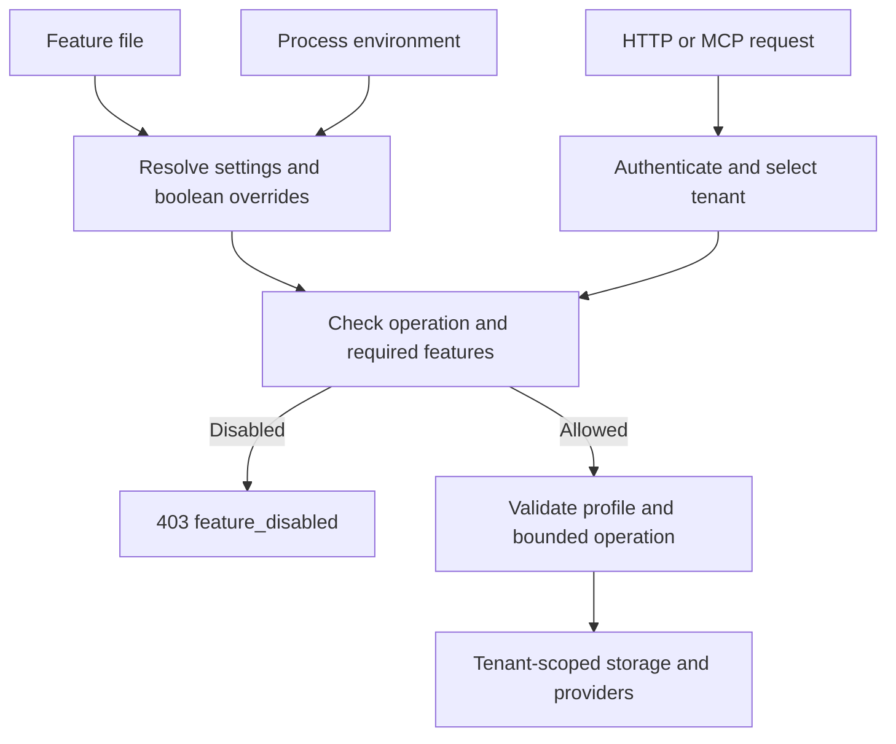

# RAGs architecture

This document describes the implemented service. The [v0.4 specification](SPEC_V04.md) adds explicit feature configuration and PostgreSQL/pgvector, extending the [v0.3 specification](SPEC_V03.md) and [v0.2 requirements](SPEC_V02.md); the [v0.3 review](IMPLEMENTATION_REVIEW_V03.md) and historical [v0.2 review](IMPLEMENTATION_REVIEW.md) distinguish actual execution, measured quality and remaining integrations. The [README](../README.md#architecture-and-flows) contains the service, ingestion and retrieval flowcharts.

## Service boundaries

FastAPI authenticates a bearer credential and derives one tenant before calling the document service or original-image service. The read-only stdio MCP bridge calls that HTTP API. The companion [agentic-system](https://github.com/MasterLKH180cm/agentic-system) has its own API, durable workflow store, and worker; the default full stack gives each service a separate PostgreSQL database and non-superuser application role. RAGs owns the native pgvector knowledge index; the workflow store does not contain that index.

Document ingestion and retrieval live in `RAGService`. `Providers` supplies hashing or trained single-vector embeddings and optional text generation. `BackendManager` supplies actual token-matrix late interaction or an explicitly configured external research protocol. Original image assets have a separate service and paired CLIP encoder; they do not masquerade as text chunks.

## Configuration and feature enforcement

`Settings` resolves operational environment configuration once per process. A
selected `RAGS_FEATURES_FILE` supplies a JSON boolean map; `RAGS_FEATURES_JSON`
overrides individual entries. The manifest in `rags/features.py` includes
interfaces, document and original-image operations, provider families, indexes,
chunkers, tokenizers and every retrieval strategy. Unknown keys, non-booleans
and invalid selected files fail startup. An enabled permission still requires
its provider, installed dependencies and compatible index profile.

Guards run before optional provider calls or mutations, including caption upload
processing and internal tokenizer use. Original-image download is independently
controlled by `original_images`; internal authorized reindexing still has access
to its source bytes. The shipped MCP bridge uses authenticated capabilities for
its tool listing and rechecks permissions on calls; HTTP remains authoritative.
`/health` and `/capabilities` expose resolved backend metadata and permissions,
without database credentials or provider keys. Feature changes require process
recreation; API capability responses do not constitute model-quality evidence.

The default Compose service uses PostgreSQL 17 and pgvector 0.8.7. Its bootstrap
role creates the database, application role and extension; the runtime role
does not install extensions. Database ports remain private, and provider/feature
settings are explicitly forwarded to the application. `RAGS_DATABASE_URL`
selects PostgreSQL without fallback. With that selector unset, `RAGS_DB_PATH`
retains the explicit SQLite development and legacy-data path.

## Source records and derived indexes

| Storage | Responsibility |
| --- | --- |
| `documents` | Current document identity, source content, and index profile |
| `document_revisions` | Source snapshots, recording time, validity interval, and processing profile |
| `chunks` | Original leaf/parent spans, generated summaries, native PostgreSQL `vector` values, tokenizer metadata, and lineage |
| Sparse index | PostgreSQL GIN full-text index with `ts_rank_cd`; SQLite compatibility uses `chunks_fts` / FTS5 |
| `graph_relations` | Entity relations with original source-chunk evidence IDs |
| `audit` | Lifecycle events committed in the same application database |
| `image_assets` | Tenant-scoped original image bytes, native PostgreSQL `vector` values, revisions, and encoder identity |

PostgreSQL stores text and original-image embeddings as native `vector` values.
Dense ranking executes exact cosine distance with `<=>` in SQL after tenant,
version and metadata scoping. There is no fixed global vector dimension: the
profile preflight rejects incompatible model/dimension selections before a
query, while explicit reindexing can replace a model profile. No ANN index or
HNSW performance claim is implied. PostgreSQL sparse ranking uses `ts_rank_cd`,
which is not the same ranking formula as SQLite FTS5/BM25.

Document changes and their sparse, hierarchy, graph and audit records commit
atomically. Application SQL uses bound parameters. The SQLite compatibility
backend retains WAL, foreign keys and bounded busy waits. The audit table is an
operational record, not a separate tamper-evident audit system.

The explicit `python -m rags.migrate --sqlite SOURCE` importer reads a source
SQLite database without modifying it, requires an empty PostgreSQL target, and
copies current/historical text, derived records and original images in one
transaction without model calls. It is an operator-run migration, not an
implicit startup operation; backups and the rollback boundary are documented
in the [README](../README.md#database-migration-and-backups).

### Atomic ingestion and reindexing

Ingestion validates the source and processing configuration, resolves the tokenizer, and constructs exact source spans. The canonical profile includes algorithm/configuration, tokenizer identity, embedding model/endpoint/dimensions, active semantic/context identities, and prompt revision. The unchanged shortcut requires matching source and profile, so a tokenizer or model change cannot silently retain an incompatible index.

Provider calls and derived-index construction happen before the write transaction. A compare-and-swap check verifies that the expected source revision is still current, then commits the source snapshot and derived records atomically. Failed inference or a concurrent change preserves the previous index. Explicit reindexing requires the expected revision. Deleting a document purges its stored revisions and derived evidence as well as its current record.

Additive schema migration marks existing unqualified records as `legacy`; it does not invent offsets/token counts or call a model. Vector retrieval rejects an incompatible or unknown profile and requests reindexing. A source reprocessing operation preserves validity when the source has not changed; a source update creates a new revision.

### Version selection and evidence lineage

Authorization and version selection precede ranking. For each document, current or `as_of` reads select the latest recorded revision valid at the requested instant, then apply metadata filters. Validity intervals include their start and exclude their end. A filter therefore cannot resurrect an older version. This supports valid-time reads and explicit updates; it does not provide automatic upstream refresh, change-data-capture connectors, or a separate transaction-time query API.

Leaf and parent records retain exact source offsets. Generated contextual prefixes remain separate from source text. Hierarchy summaries store original-leaf lineage and expand into original leaves for citations. Graph traversal uses relations whose evidence IDs are already in the authorized revision scope. Hypothetical HyDE documents and generated summaries are never accepted as original source citations.

## Text processing and prompt budgets

The six ingestion strategies are fixed, recursive, structure, parent-child, semantic, and contextual. Semantic boundaries require a trained encoder; contextual prefixes require a generator. Missing required dependencies produce an error. Structure parsing recognizes text/Markdown blocks and heading paths; it is not a PDF layout parser.

Unicode code-point counting is an explicit baseline. Tiktoken resolves a known model or explicit encoding and preserves character boundaries when producing source spans. Stored counts identify their tokenizer and counting unit. Source chunking and generation can use different tokenizers; selecting a correct model encoding remains an operator responsibility for custom compatible endpoints.

Before generation, the service packs the rendered instructions, question, citation headers, separators, and evidence within the configured context budget after reserving output and envelope allowances. The response records included/dropped/truncated sources and counting provenance. An oversized fixed prompt fails rather than dropping the question. Unicode counts and reserved framing estimates are not presented as exact provider token accounting.

## Retrieval execution

| Mechanism | Execution and dependency boundary |
| --- | --- |
| Sparse, dense, naive, hybrid | PostgreSQL full-text or SQLite FTS5 ranking, exact cosine search, direct evidence assembly, and independent rank fusion |
| Parent-child, hierarchy | Persisted parent expansion or recursive vector clusters/summaries with original-leaf lineage |
| Graph | Explicit or validated model-extracted relations; two-hop traversal and label-propagation communities |
| Structured | Typed row/metadata predicates and bounded numeric aggregations; no submitted SQL |
| Temporal | Authorized version selection and recency-aware ranking |
| Fusion, HyDE, contextual | Distinct query-generation, hypothetical-document, or contextual-index mechanisms; required generation/index dependencies are explicit |
| Corrective, adaptive, agentic, self-reflective | Validated routing/planning/evidence review/draft critique, with at most three refinement rounds |
| Multi-vector / ColBERT | Real pretrained query/document token matrices and normalized masked sum-MaxSim |
| Image assets | Paired CLIP text/image vectors, cosine ranking, and original-image citations through `/assets/*` |
| Federated | Operator-defined source IDs and per-tenant credentials, bounded parallel reads, source-qualified IDs, and RRF |

The native hierarchy, native graph and reflection loop keep their own names. Separate `raptor` and `lightrag` identifiers execute pinned upstream implementations through the request-local service below. `full_graphrag`, `hipporag`, `self_rag` and `crag` still expose only the generic external contract. They do not become implemented papers because a native path has a similar purpose. See the [remaining upstream ledger](RESEARCH_ENGINES.md).

Model-dependent paths validate structured outputs, permitted choices, and source IDs. Bounded loops record decisions and stopping reasons. There is no arbitrary shell execution or general-purpose tool execution in this RAG service. The companion workflow runtime owns its own tool and approval policies.

## Evidence decisions and profile identity

`EvidenceAdmission` runs on original authorized passages before answer generation,
including when `generate=false`. Its result separates successful retrieval from
insufficient evidence, and identifies unassessed ranking, calibrated relevance,
calibrated answerability, explicit model review or exact structured data. A
refusal removes all usable citations. Candidate IDs/counts remain separate
diagnostics and cannot become downstream evidence.

Compatibility without a profile is explicitly unassessed. Required policy needs
a configured immutable profile for ordinary passage evidence. The profile
fingerprints actual model/config/tokenizer artifacts, runtime, scoring convention,
prompt/window, calibration digest and threshold. It cannot be selected by a
request. Invalid profiles, unavailable artifacts and malformed scores are
execution errors. Exact structured aggregates carry complete bounded dataset
provenance and do not fabricate rows for a zero result.

BGE computes relevance logits through its actual ONNX cross-encoder. Qwen uses a
pinned local CPU model, a fixed source-only instruction and next-token YES/NO
logit difference. Both use maximum original-passage score and retain candidate
order/set on acceptance. Qwen's single-passage question is a material limitation
for questions requiring multiple passages together; no profile is promoted by
passing protocol tests. Calibration and held-out measurements remain separate.

The process caches only model state and profile identity. Inference is bounded;
source-prefix truncation and full prompt windows are explicit. User evidence and
scores do not become a shared model cache. Federation validates remote decisions
and removes refused branches before rank fusion. A separately admitted branch
may still contribute evidence.

## Request-local research execution

The authenticated research sidecar hosts one fixed RAPTOR or LightRAG engine. Both supplied upstream adapters require the `tokenizer.tiktoken` permission because their provider bridge enforces actual encoder token windows.
The RAG service sends the original passages already selected for tenant,
metadata and time. The sidecar verifies its credential's tenant and the fixed
engine before starting the worker. A finite semaphore bounds active requests;
capacity exhaustion returns 429 rather than accumulating an unbounded queue.

Each request uses a fixed `python -m rags.research_worker` command, a fresh
working directory and a fresh temporary index. Its environment contains only
runtime and selected provider configuration, not RAG/Agent tenant credential
maps. Source-derived caches/logs are request-local; public weights may be shared.
A complete wall timeout bounds stdin/output exchange. Output is read through a
bounded pipe; failures expose fixed codes. Completion, timeout and cancellation
terminate the process group and remove the temporary directory.

RAPTOR runs upstream cluster/tree construction and retrieval. It traces selected
summaries through child nodes to authorized original leaves. LightRAG initializes
its upstream stores, extracts/merges a graph and performs hybrid graph retrieval.
It resolves internal chunk records and checks both original identity and content.
Neither generated summaries nor extracted entity descriptions become standalone
citations. The provider bridge checks exact encoder token windows before calls,
as well as generation input/output and call-count bounds.

The client validates exact pinned implementation metadata and bounded diagnostic
fields when present or required. Such metadata is labelled upstream-reported;
actual source/model execution is established by the independent test reports.
No health response or configured URL is treated as algorithm verification.

## External boundaries and authorization

The caller cannot select a tenant, backend URL, or backend credential. Federation and research endpoints come from operator configuration; each tenant has a distinct mapped credential. Requests carry only already authorized source passages or source-scoped query parameters. Research responses can select IDs only from the supplied original leaf records. Federation IDs are source-qualified to prevent collisions.

HTTP adapters reject redirects and compressed responses and enforce byte limits before buffering. Research requests use one asyncio wall deadline spanning connection, headers and all body reads; the synchronous API facade owns that event loop. Federation retains its separately bounded transport checks. Numeric scores, aggregation values, usage fields and token matrices reject nonfinite values and inappropriate types. Invalid Unicode bearer credentials return unauthorized responses. Provider failures remain execution errors.

All document, archive, parent, graph, and original-asset operations use tenant scope. This service's static key map is not OIDC, document-level ACL management, or a complete public API gateway. External services still need appropriate source handling, retention, and credential isolation; local protocol validation cannot prove their internal behavior.

## Evaluation and operational limits

The historical [36-question synthetic report](evaluation-v02-summary.json) records offline hybrid Recall@3 `0.85` and no-answer refusal recall `0.0`. The v0.3 evaluation separates raw candidates from admitted evidence and records the frozen quality gates independently from contract tests. Record-valid citations establish source identity and span, not entailment. Actual RAPTOR/LightRAG execution uses real embeddings and labelled deterministic generation fixtures; live paid-generation quality remains unverified.

Actual BGE, ColBERT, and paired CLIP checkpoints were exercised separately. These small fixtures verify encoder/adapter execution and selected invariants; they are not domain-quality benchmarks. Ordinary tests also distinguish deterministic control-flow fixtures from real-model inference.

Exact pgvector scans, the serialized application transaction paths, on-demand late-interaction encoding and local federation threads retain workload-dependent scaling limits. SQLite remains a development and legacy-storage option. The service does not currently implement a distributed vector index, automatic streaming refresh, production identity gateway, quotas, or semantic answer-verification guarantees. Scaling and public deployment require those concerns to be addressed explicitly; they are not implied by passing local integration tests.

## v0.9 model capability and checkpoint boundaries

`rags/model_profiles.py` owns the selected provider's supported request fields,
strict JSON decoder and normalized usage. Both `Providers` and `ModelRouter`
consume that contract; an OpenAI-compatible URL alone never implies JSON-schema
support. Tinker/Inkling uses `max_completion_tokens`, optional explicit reasoning
effort, and independently configured embeddings. UTF-8-byte budgeting preserves
Unicode boundaries and advertises its conservative counting provenance.

`rags/provider_transport.py` is the direct generation, embedding and vision HTTP
boundary. It bounds complete JSON requests before I/O (1 MiB, or 3,000,000 bytes
for image encoding), rejects redirects/compression before body reads, and streams
at most 512 KiB under one wall deadline. Its synchronous façade owns and closes
the request event loop, including when called from an existing async context.

The router bounds the entire request, including tool schemas, rejects compressed
responses, duplicate JSON fields, nonfinite numbers, undeclared or inconsistently
terminated tool calls and malformed envelopes. Cache or reasoning usage is
reported only if actually supplied by the provider. Bounded reasoning continuation text is kept only in the private run checkpoint
and replayed to the model; public reply/checkpoint serialization, agent API
summaries and conversation/observation memory exclude it. This preserves tool
continuity through approval/restart without exposing internal reasoning in the
product interface.

The execution plane checks truncation before any tool action and binds durable
approvals to the complete registered schema/policy/model contract. A changed
contract requires a new run; a retry cannot silently authorize a changed tool.
The versioned v0.9 fingerprint intentionally invalidates v0.8 pending agent
approvals and resumable agent checkpoints; operators must start new runs and
review new approval requests after upgrading.
Read-only history access retains tenant/owner checks without requiring a match
to the current runtime fingerprint.
Existing tenant scopes, compare-and-swap revisions and idempotent-tool rules
remain authoritative. See [SPEC_V09](SPEC_V09.md) for the observed defects and
required regressions.
