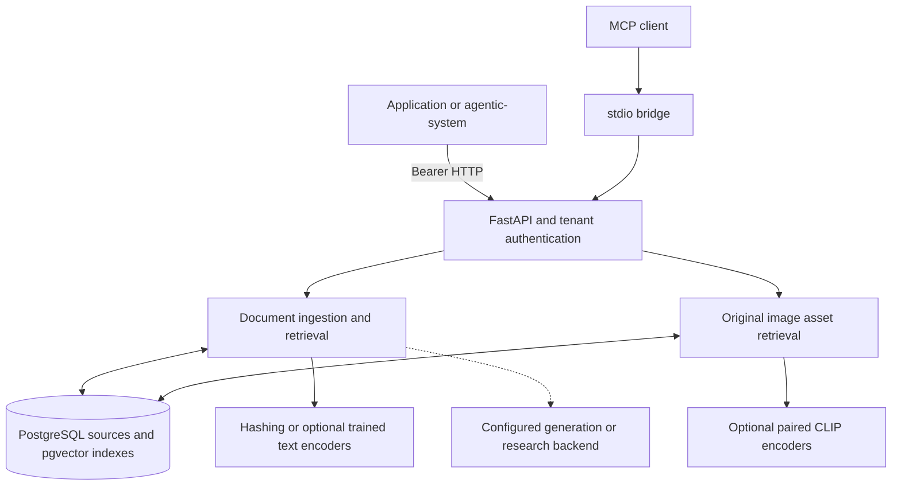
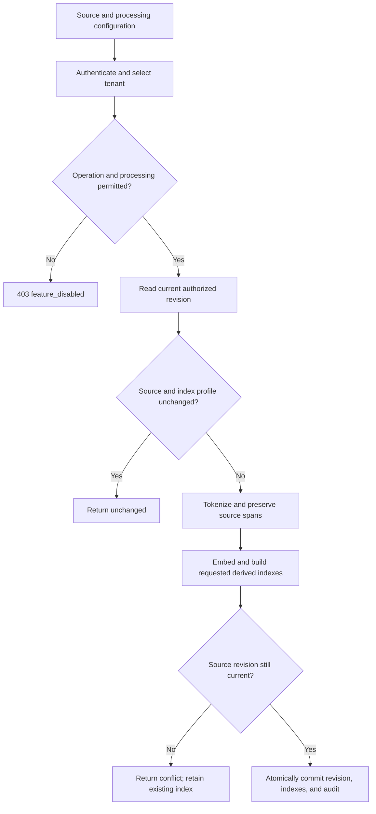
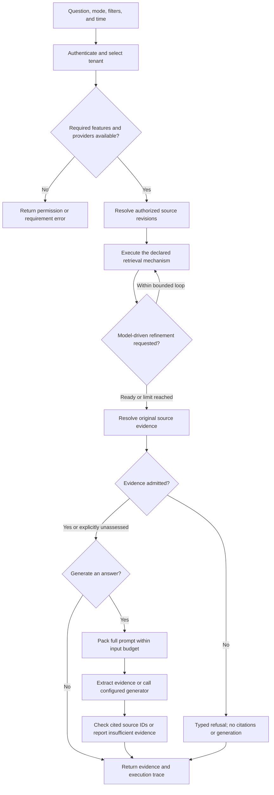

# Operations, architecture and validation reference

Start with the [README quick start](../README.md#quick-start) for installation
and a first authenticated query. This reference keeps the detailed model,
deployment, architecture, migration and historical validation material.
Versioned test counts describe their recorded commits, not the current test inventory.

**Source-preserving retrieval with configurable chunking, versioned indexes, bounded model workflows, and explicit capability reporting.**

[](https://github.com/MasterLKH180cm/RAGs/actions/workflows/ci.yml)
[](../pyproject.toml)
[](../LICENSE)

RAGs provides an authenticated FastAPI knowledge service and a read-only MCP bridge. Use it directly or connect [agentic-system](https://github.com/MasterLKH180cm/agentic-system) for durable workflows. The default runs without paid model credentials, using clearly identified hashing embeddings and extractive evidence output.

Version 0.6 adds tenant-scoped roles and opt-in OAuth2 introspection with strict per-operation scope checks; review [SECURITY_V06](SECURITY_V06.md). Version 0.5 adds the installable CLI, five operator profiles, read-only doctor, and measured revision-scoped PostgreSQL reads; see the [synthetic performance report](PERFORMANCE_V05.md) and [v0.5 specification](SPEC_V05.md). Version 0.4 adds operator feature permissions, dedicated model endpoint configuration, and a PostgreSQL/pgvector deployment; see the [v0.4 specification](SPEC_V04.md). Version 0.3 adds typed evidence decisions, separately calibrated relevance and answerability profiles, and isolated services executing pinned RAPTOR and LightRAG code. It builds on v0.2's six chunking strategies, token budgets, parent/summary indexes, graph traversal, structured queries, temporal revisions, federation, and pretrained encoders. The [twenty-family coverage table](#twenty-family-coverage) distinguishes native mechanisms, tested upstream execution, and remaining external requirements. An unavailable capability returns an explicit error instead of silently running another strategy.

The v0.9 upgrade adds explicit model protocol capabilities, Inkling 2 Mini
configuration, conservative UTF-8 budgeting, and approval checkpoints bound to
model/tool contracts. See [the specification](SPEC_V09.md). Model fixtures
verify compatibility; they do not establish live model quality or speed.

The [whole-code review corrections](#whole-code-review-corrections) strengthen
source validity, migration, resource bounds and durable native-agent state.
The [optional shared LiteLLM gateway](LITELLM.md) adds a separately deployed
generation path; the default remains local hashing embeddings and extractive
answers, with no model credentials required.

The [Qwen local generation recipe](SELF_HOSTED_QWEN_SPEC.md) adds a pinned
Qwen3-1.7B Q8_0 CPU deployment and `qwen-local` / `qwen-litellm` live benchmark
presets. It is separate from the original bfloat16 answerability scorer and its
frozen quality gates. [Evaluation diagnostics](QWEN_EVALUATION_SPEC.md)
separate missing reference documents from references removed after retrieval.

The new [Collections API and Python SDK](COLLECTIONS.md) add Chroma-inspired
record workflows: atomic batches, explicit embedding spaces, metadata arrays,
bounded text/regex filters, dense/BM25/sparse/hybrid ranking, grouped projections,
and independent dataset forks. The service retains PostgreSQL/pgvector and the
existing evidence admission pipeline. The [implementation contract](COLLECTIONS_SPEC.md)
defines the API and its measured-scope limits.

## Contents

- [Quick start](#quick-start)
- [Collections and Python SDK](#collections-and-python-sdk)
- [Agent Platform: model routing, workflows and memory (v0.8)](#agent-platform-model-routing-workflows-and-memory-v08)
- [Admin Dashboard and OpenTelemetry (v0.7)](#admin-dashboard-and-opentelemetry-v07)
- [Tenant authorization and OAuth2](#tenant-authorization-and-oauth2)
- [Inkling 2 Mini](#inkling-2-mini)
- [Optional shared LiteLLM gateway](#optional-shared-litellm-gateway)
- [Installable CLI](#installable-cli-no-clone-needed)
- [uv environment workflow](#uv-environment-workflow)
- [Ingest and query](#ingest-and-query)
- [Architecture and flows](#architecture-and-flows)
- [Chunking and token budgets](#chunking-and-token-budgets)
- [Twenty-family coverage](#twenty-family-coverage)
- [Evidence admission and refusal](#evidence-admission-and-refusal)
- [RAPTOR and LightRAG services](#raptor-and-lightrag-services)
- [Structured and temporal queries](#structured-and-temporal-queries)
- [Pretrained encoders and image assets](#pretrained-encoders-and-image-assets)
- [Model providers and federation](#model-providers-and-federation)
- [Feature and operational configuration](#feature-and-operational-configuration)
- [Database migration and backups](#database-migration-and-backups)
- [MCP and API reference](#mcp-and-api-reference)
- [Validation and measured limits](#validation-and-measured-limits)
- [Deployment and project map](#deployment-and-project-map)

## Collections and Python SDK

Use a collection when each caller-supplied record corresponds to one vector.
Use the existing document API when a long source needs automatic chunking.
Both interfaces use the configured authentication, tenant boundaries and feature flags.

```python
import os
from rags.client import HttpClient

with HttpClient("http://127.0.0.1:8000", api_key=os.environ["RAGS_API_KEY"]) as client:
    notes = client.get_or_create_collection("product-notes")
    notes.upsert(
        ids=["storage", "retention"],
        documents=["Backups are encrypted at rest.", "Logs are retained for 30 days."],
        metadatas=[{"tags": ["security", "storage"]}, {"tags": ["operations"]}],
    )
    hits = notes.search(query_texts=["encrypted backups"], mode="hybrid",
                        where={"tags": {"$contains": "security"}})
    print(hits.rows())
    experiment = notes.fork("product-notes-experiment")
    experiment.update(ids=["retention"], documents=["Logs are retained for 60 days."])
    answer = notes.ask("How long are logs retained?", mode="lexical")
    print(answer["answer"], answer["citations"])
```

`PersistentClient(path, api_key=...)` offers the same collection operations with
an authenticated local SQLite store; its default is explicitly offline. Pass
validated settings, or use `PersistentClient.from_env`, to opt into configured
models. The HTTP client uses the server's provider configuration. Dense queries
can instead supply matching precomputed vectors. Default local embeddings are
deterministic hashing, not a trained semantic model.

```bash
rags collection --help
rags records --help
rags search --help
```

Forks share immutable text, metadata and vectors, then copy O(record-count)
mapping rows. Changes and deletion are isolated; a fork survives deletion of its
source collection. Search supports cosine, actual BM25, explicit-space sparse
dot products and positive weighted reciprocal-rank fusion. Collection `ask`
uses the existing admission, context budgeting and versioned source citations;
raw rankings remain `ranked_unassessed`.

This is the RAGs API, not Chroma wire compatibility or a Chroma Cloud performance
claim. Defaults bound each collection to 10,000 records, each mutation to 100
records, a search batch to 16 queries, and scans/responses to 16 MiB/2 MiB.
See [the usage guide](COLLECTIONS.md) for complete SDK, CLI, filters,
embedding and authorization examples.
See [validation and measured performance](COLLECTIONS_VALIDATION.md) for the
test scope, reproducible commands and synthetic SQLite/PostgreSQL p50/p95 data.

## Tenant authorization and OAuth2

The original tenant API key model allowed all document operations within the tenant. V0.6 retains it for compatibility but supports explicit per-key roles and an independent, opt-in OAuth2 Resource Server. **Feature flags are not a substitute for identity permissions.**

### API key roles

```bash
export RAGS_KEYS_JSON='{"REPLACE_WITH_READER_KEY":"tenant-a","REPLACE_WITH_EDITOR_KEY":"tenant-a"}'
export RAGS_KEY_ROLES_JSON='{"REPLACE_WITH_READER_KEY":["reader"],"REPLACE_WITH_EDITOR_KEY":["editor"]}'
```

| Role | Scope grants |
| --- | --- |
| reader | `rags:read`, `rags:query` |
| editor | reader + `rags:write`, `rags:reindex` |
| admin | all, including `rags:delete`, `rags:generate`, `rags:original_image`, `rags:mcp` |

If `RAGS_KEY_ROLES_JSON` is absent, **every legacy key has admin-equivalent permissions**. When set, it must cover all keys and use known roles. Use secret storage for the mapping.

### OAuth2 access-token introspection (RFC 7662)

```bash
export RAGS_AUTH_MODE=oauth2_introspection
export RAGS_KEYS_JSON='{}'
export RAGS_OAUTH2_INTROSPECTION_URL=https://idp.example.com/oauth2/introspect
export RAGS_OAUTH2_ISSUER=https://idp.example.com/
export RAGS_OAUTH2_AUDIENCE=rags-api
export RAGS_OAUTH2_CLIENT_ID=rags-service
export RAGS_OAUTH2_CLIENT_SECRET_FILE=/secrets/rags-introspection-secret
# Optional: RAGS_OAUTH2_TENANT_CLAIM=tenant_id
# Optional: RAGS_OAUTH2_TIMEOUT_SECONDS=3
rags doctor --no-db
rags serve
```

The authorization server must return an **active** authenticated introspection response with exact `iss`, `aud`, nonempty `sub`, fixed `tenant_id`, future `exp` and a space-delimited `scope`, e.g. `rags:read rags:query`. Ignore unrelated scopes such as `openid`. Additional scopes: `rags:write`, `rags:reindex`, `rags:delete`, `rags:generate`, `rags:original_image` (also requires read), and `rags:mcp`.

The endpoint uses HTTPS, Basic client authentication, rejects redirects/invalid claims, and does not cache introspection. Missing/invalid credentials yield 401; insufficient scope yields 403; unavailable IdP yields 503. **This is resource-server OAuth2, not an OIDC login, JWT signature validator or Authorization Code+PKCE client.** See [security audit](SECURITY_V06.md) for remaining RLS, per-document ACL and production risks.


## Admin Dashboard and OpenTelemetry (v0.7)

The optional, self-hosted **RAGs Control Center** provides an accessible, responsive administration UI at [/admin/](http://127.0.0.1:8000/admin/). It includes:

- **Overview:** document, revision, leaf-chunk, and image asset counts for the authenticated tenant; recent document audit events and a 60-minute activity chart.
- **Knowledge library:** server-side search and pagination, source ingestion, and **revision-checked deletion** using typed ID confirmation (CAS + CSRF).
- **Retrieval Studio:** compare sparse/dense/hybrid/temporal/structured modes, inspect evidence citations and optionally request a model-generated answer. Model generation is **off by default** in the UI.
- **Observability:** last-five-minute request count, server 5xx rate, p50/p95 latency, OTLP export/dropped/error indicators. Dashboard metrics are process-local and bounded, **not** whole-cluster telemetry.
- **Configuration:** effective permissions and feature flags, current auth mode and provider/storage names, without any passwords, tokens, connection strings or raw prompt data.

All HTML/CSS/JavaScript is **included in the Python wheel**. The interface has keyboard-accessible labels, focus states, readable high-contrast colors, dark/light appearance, responsive mobile navigation, loading/empty/error states, and respects `prefers-reduced-motion`. It does not load external scripts, fonts, or analytics, or persist credentials in browser storage. The only localStorage value is the visual theme.

### Secure login, roles and deployment

The dashboard is **disabled by default**, even when API documentation is available. When enabled, access requires `rags:admin` **and** `rags:read`. The existing API key `admin` role grants `rags:admin`; OAuth2 introspection tokens must explicitly include `rags:admin rags:read` (and additional operation scopes for query/write/delete).

```bash
# Native local development with the generated offline profile:
rags init --profile offline
# Set these three values in .env or export them:
export RAGS_ENV=development
export RAGS_ADMIN_ENABLED=true
export RAGS_ADMIN_DEV_HTTP=true
rags serve --env-file .env
# Open http://127.0.0.1:8000/admin/ and sign in using your generated admin key.
```

The browser submits the bearer credential exactly once, receives only a 30-minute opaque `HttpOnly` session cookie, and never stores it as a JavaScript-readable browser secret. The server retains the credential in **bounded process memory** and revalidates it on **each** request (OAuth2 revocation takes effect immediately). Mutating requests require a per-session CSRF nonce and same-origin check. Unknown/non-admin tokens cannot use the dashboard; the public API does **not** accept cookies instead of Bearer credentials.

In production use HTTPS behind a trusted reverse proxy that correctly forwards scheme/Host and restricts upstream access. Cookies use `__Host-rags_admin` with `Secure; HttpOnly; SameSite=Strict; Path=/`. A separate non-Secure cookie is permitted **only** on explicit loopback HTTP in development/test. `RAGS_ADMIN_DEV_HTTP=true` fails startup in production. Default Docker Compose is production-mode; accessing its bare loopback HTTP without HTTPS will show the login page but reject login. A public TLS reverse proxy, secure routing and authentication/abuse protection are production responsibilities.

**Important session limitations:** In-memory sessions are lost on restart and do not synchronize across workers/replicas. Use a single web worker or sticky affinity; add durable, encrypted server-side session storage and an OIDC authorization-code/PKCE browser login for distributed SSO. A TLS reverse proxy is not a substitute for the existing OAuth2/Bearer authorization checks.

In **production API-key mode**, enabling `RAGS_ADMIN_ENABLED=true` also requires a complete, explicit `RAGS_KEY_ROLES_JSON` at startup. This prevents inadvertently exposing the dashboard to all legacy full-access keys. Dashboard exporter success/failure/dropped counters are tenant-scoped; process-global exporter counters are never shown to other tenants.

### OTLP/HTTP traces and metrics

RAGs optionally exports **real OTLP/HTTP JSON** using the existing `httpx` dependency, with a bounded asynchronous queue. This is a minimal OTLP protocol exporter, **not the OpenTelemetry Python SDK's automatic instrumentation**. The service uses standard OpenTelemetry trace/metric JSON envelopes with route-template names and service resource attributes. No query text, source content, original URLs/document IDs, raw tenants, bearer values, headers, cookies, model payloads or stack traces are exported. Export failures never prevent API requests.

```bash
# External TLS-protected collector:
export RAGS_OTEL_ENABLED=true
export RAGS_OTEL_ENDPOINT=https://otel-collector.example.com:4318
export RAGS_OTEL_SERVICE_NAME=rags-platform
rags serve --env-file .env
```

An **optional local OpenTelemetry Collector** profile is supplied for reproducible development. It has no externally published ports, and the debug exporter **prints sanitized telemetry to its container logs**, so retain logs only as needed. It is not a production observability backend.

```bash
# After running scripts/bootstrap_compose.py, edit .env:
# RAGS_OTEL_ENABLED=true
# RAGS_OTEL_ENDPOINT=http://otel-collector:4318
# RAGS_OTEL_ALLOW_INSECURE=true   # private Compose network only
docker compose --profile observability up -d --build --wait
docker compose logs --tail=100 otel-collector
```

The service collector target is **operator-configured**, never supplied by API callers. HTTP endpoints require an explicit insecure opt-in; production exporters should use TLS and collector-side authentication. The included example Collector routes traces/metrics to its debug exporter; replace its pipelines with your approved secure telemetry backend and retention policy. Refer to [OpenTelemetry Collector docs](https://opentelemetry.io/docs/collector/install/docker/) and the [OTLP specification](https://opentelemetry.io/docs/specs/otlp/) for production Collector setup.

Default `RAGS_OTEL_ENABLED=false` retains existing offline operation and does not initiate exporter network traffic. The dashboard's built-in pulse still works, but its measurements are bounded and process-local. Saturation can truncate the recent-request sample; this is not a billing, SLA, audit or clinical safety reporting system.

See [v0.7 design contract](SPEC_V07.md) and [security/operations review](REVIEW_V07.md) for security boundaries, accessibility notes and known limitations.


## Agent Platform: model routing, workflows and memory (v0.8)

The **default-enabled** Agent Platform provides one typed router interface, bounded tool-calling agents, a programmable workflow graph, durable human-in-the-loop checkpoints, and tenant-scoped conversation/observation memory. It uses the existing `rags-platform` wheel and PostgreSQL/pgvector or SQLite database, with no new mandatory dependency.

### One model interface across 40+ upstream providers

The adapter uses an **operator-controlled LiteLLM Gateway**, which implements an OpenAI-compatible `/v1/chat/completions` interface and publishes support for 100+ upstream model providers. This includes OpenAI, Anthropic, Google Gemini and xAI. **This project does not implement or live-test 40 provider-specific APIs.** It validates the one Gateway transport and normalizes text, structured function calls and token usage. Each alias maps to an explicitly approved provider/model route; the client cannot pick its own server URL or upload provider credentials. Select an upstream model with the syntax appropriate to your actual LiteLLM Gateway configuration.

```bash
# Configure an existing TLS-protected LiteLLM Gateway and its upstream credentials.
# Keep the gateway key in an access-restricted file, separate from client bearer keys:
export RAGS_ROUTER_ENABLED=true
export RAGS_ROUTER_GATEWAY_URL=https://litellm.example.com/v1
export RAGS_ROUTER_API_KEY_FILE=/secrets/rags-gateway-key
export RAGS_ROUTER_MODELS_JSON='{"main":"openai/gpt-4.1-mini","analyst":"anthropic/claude-sonnet-latest","google":"gemini/gemini-2.5-pro","xai":"xai/grok-latest"}'
export RAGS_AGENT_ENABLED=true
export RAGS_MEMORY_ENABLED=true

# Show configured model aliases; this does not contact the provider.
rags agent doctor --json
rags serve
```

The Gateway deployment is independent: see [LiteLLM supported providers](https://docs.litellm.ai/docs/providers) and [Gateway documentation](https://docs.litellm.ai/docs/). Models, API keys and supported tool-call features vary by provider and account. Gateway credentials and cost/rate-limit policies are operator responsibilities. No automatic model fallback, provider-wide feature parity, hidden remote endpoint or unverified output cost claim is made.

### Use the same Gateway for RAG generation and embeddings

Existing RAG endpoints now accept `router` as both `RAGS_MODEL_PROVIDER` and
`RAGS_EMBEDDING_PROVIDER`. The same configured LiteLLM Gateway handles
chat completion and the standard `/v1/embeddings` interface; no upstream-specific
request code is needed. Approved aliases are mandatory and changing the
resolved embedding model, gateway endpoint or explicit embedding-space version
creates a distinct embedding index profile.

```bash
export RAGS_MODEL_PROVIDER=router
export RAGS_GENERATION_MODEL=main
export RAGS_EMBEDDING_PROVIDER=router
export RAGS_EMBEDDING_MODEL=embed
export RAGS_EMBEDDING_SPACE_ID=embedding-deployment-v1
export RAGS_ROUTER_MODELS_JSON='{"main":"anthropic/claude-sonnet-latest","embed":"openai/text-embedding-3-small"}'
# Set RAGS_ROUTER_GATEWAY_URL and RAGS_ROUTER_API_KEY[_FILE] to your own Gateway.
rags doctor --no-db
```

Select only actual Gateway model groups that your deployment has registered.
An embedding model must support `/v1/embeddings`; a chat model must support
`/v1/chat/completions`. The software rejects malformed or non-finite vectors,
unknown aliases, partial chat completions and model calls without credentials.
Keep the embedding-space version immutable and reindex when it changes. Old
router profiles that recorded only the literal `router` endpoint require
reindexing after this upgrade. The supplied [LiteLLM profile](LITELLM.md)
routes generation only and retains local embeddings; the embedding example
above is a separate operator configuration.

### Bounded agents, scopes and APIs

All three platform switches—`RAGS_AGENT_ENABLED`, `RAGS_ROUTER_ENABLED`, and `RAGS_MEMORY_ENABLED`—default to **true**. Set any of them to `false` to disable that feature. Without a configured Gateway, the service still starts; `router_ready=false` and `503 router_unconfigured` prevent external inference. The built-in local evidence-review workflow works without the Gateway. When memory is enabled **and the caller has `rags:memory` permission**, successful agent runs automatically save their user request and assistant answer, including only verified citation IDs; observation writes require explicit input/approval. To avoid storing any agent conversation history, set `RAGS_MEMORY_ENABLED=false`. `rags agent doctor --json` reports `configuration_required` and exits nonzero until a trusted Gateway is configured.

The HTTP API uses existing Bearer authentication and tenant identity:

```bash
# Requests require an access token scoped to rags:agent + rags:generate.
# The optional agent_runner API key role grants rags:read, rags:query,
# rags:generate, rags:agent and rags:memory.
curl -X POST http://127.0.0.1:8000/agents/runs \
  -H "Authorization: Bearer $RAGS_API_KEY" \
  -H "Content-Type: application/json" \
  -d '{"goal":"What is the policy?","model":"main","session_id":"example"}'

# Safe, local CLI mode: read goal from file instead of process command line.
rags agent run --goal-file ./goal.txt --model main --session example
```

The returned run object includes a random `run_id`, `revision`, `status`, final `answer`, and a pending tool request only when a human decision is needed. To approve or reject a gated operation, call `POST /agents/runs/{run_id}/resume` with `{"expected_revision":2,"approved":true}` (substitute the actual checkpoint revision), or run `rags agent review --run-id ID --revision N --approve` with the user-scoped local CLI. Never approve an unknown tool blindly.

The built-in tools are `knowledge_search` (existing evidence-grounded RAG, `rags:query` scope) and, when memory is enabled, `remember_observation` (`rags:memory`, **mandatory human approval** before writing). Operators can register additional Pydantic-validated Python tools through `ToolRegistry`; end users cannot submit tool code or unrestricted URLs to the server. The engine stops on completion, maximum steps, tool calls, deadline, repeated tool loops or invalid provider output. `RAGS_AGENT_MAX_STEPS` (default 6; max 8) and `RAGS_AGENT_MAX_TOOL_CALLS` (default 12; max 16) are hard caps. `RAGS_AGENT_MAX_RUNTIME_SECONDS` (default 60; max 90) limits Gateway requests and the **HTTP wait for explicitly declared read-only tools**; up to eight timed-out read-only workers can finish asynchronously, but their results are discarded. Trusted side-effecting Python tool callbacks cannot be forcibly interrupted safely and must implement cooperative timeouts, idempotency and downstream cancellation. Do not treat the runtime value as a hard kill of arbitrary user code.

### Code-first graph workflows and human checkpoints

`Workflow` provides `.then()`, `.branch()`, and `.parallel()` with **operator-registered** Python functions. Branches choose one of two actions; parallel branches have deterministic output collection, bounded concurrency (max four) and require explicit idempotency. An approval-gated `.then(approval=True,idempotent=True)` checkpoint waits for a human and does not call the action before approval. The graph is defined in code, not generated as executable instructions from a user prompt.

```python
from rags.storage import Store
from rags.agents.state import StateStore
from rags.agents.workflow import Workflow

state = StateStore(Store("data/rags.db"))
flow = (
    Workflow("review", version="v1")
    .then("retrieve", lambda ctx: {"retrieved": True})
    .branch("quality", lambda ctx: ctx.outputs["retrieve"]["retrieved"],
            if_true=lambda ctx: {"approved": True},
            if_false=lambda ctx: {"approved": False})
    .parallel("checks", {"metadata": lambda ctx: "ok", "license": lambda ctx: "ok"},
              idempotent=True)
    .then("publish", lambda ctx: {"published": True}, approval=True, idempotent=True)
)
waiting = flow.start(state, "tenant-a", {"document_id": "example"})
assert waiting.status == "waiting_for_approval"
finished = flow.resume(state, "tenant-a", waiting.run_id,
                       expected_revision=waiting.revision, approved=True)
assert finished.status == "completed"
```

The durable state, revision CAS, and immutable graph version fingerprint live in the same tenant-scoped database. **For an external side-effecting step, idempotent retries must be implemented by the operator**; a process crash between a side effect and a checkpoint is not an exactly-once guarantee. Workflows are Python DSL graphs, not a drag-and-drop editor in this release.

### Interactive workflow graph and CLI

The **Agents** page in the Admin Dashboard includes a visual graph of registered
sequential, conditional, parallel and human-approval steps. It supports execution,
approve/deny and checkpoint recovery. It does not execute arbitrary Python
submitted from the browser: workflows are defined by trusted operators.

```bash
# Available without a cloud model: operates on authorized local RAG evidence.
rags workflow list
printf 'What are the records retention requirements?\n' > question.txt
rags workflow run --template evidence_review --question-file question.txt --mode sparse
rags workflow status --run-id RUN_ID
rags workflow review --run-id RUN_ID --revision REVISION --approve
rags workflow recover --run-id RUN_ID --revision REVISION
```

The corresponding endpoints are `GET /agents/workflows`,
`POST /agents/workflows/evidence_review/runs`,
`GET /agents/workflows/runs/{run_id}`,
`POST /agents/workflows/runs/{run_id}/resume`, and
`POST /agents/workflows/runs/{run_id}/recover`. Authorization requires
`rags:agent` and `rags:query`; dashboard requests also require `rags:admin`,
a session cookie and CSRF validation. Runs are restricted to their creator
and tenant, and stale checkpoint revisions are rejected.
### History and observation memory

Each API conversation is stored under `(tenant, verified subject, session_id)` using an internal subject-derived namespace, with bounded retrieval of at most 20 recent turns. `ObservationStore` records short, explicitly supplied/approved facts with provenance, confidence, deterministic deduplication and TTL (default 30 days, configurable via `RAGS_MEMORY_TTL_DAYS`). Expired facts are excluded from prompt context. Memory, RAG citations and model outputs are **untrusted context**, not executable commands or authorization data. Memory is never written when `RAGS_MEMORY_ENABLED=false`.

```bash
# Authorize rags:agent + rags:memory to read/write tenant session facts.
curl -X POST http://127.0.0.1:8000/agents/sessions/example/observations \
  -H "Authorization: Bearer $RAGS_API_KEY" \
  -H "Content-Type: application/json" \
  -d '{"fact":"User explicitly prefers concise answers","source_id":"consent-record"}'
```

Conversation and observation records are persisted as plaintext in the selected DB; use encryption at rest, retention policy, sensitive-data minimization, app-level tenant scopes, restricted database access and appropriate legal basis before storing confidential records. A future feature should add configurable privacy filters, encryption, moderation and user deletion lifecycle, especially for healthcare data. RLS, dynamic source ACL and autonomous personal-profile inference remain outside scope.

See [v0.8 spec](SPEC_V08.md) and [implementation review](REVIEW_V08.md) for exact contracts, limitations, and test coverage.

## Quick start

### Inkling 2 Mini

Inkling 2 Mini has downloadable open weights. The `inkling` profile below selects
the optional hosted Tinker service; [`inkling-local`](#self-hosted-inkling) uses
an independently installed local model server without a hosted API key.

The published model ID is `thinkingmachines/Inkling-2-Mini`. The official Tinker
endpoint is `https://tinker.thinkingmachines.dev/services/tinker-prod/oai/api/v1`.
Its OpenAI-compatible protocol uses **`max_completion_tokens`** and accepts
`reasoning_effort`. Tinker documents `response_format` as ignored, so RAGs always
validates JSON and registered tool arguments locally. See the official
[model card](https://thinkingmachines.ai/model-card/inkling-2-mini/) and
[chat API](https://tinker-docs.thinkingmachines.ai/inference/openai/chat-completions/).

Create a profile in an empty configuration directory:

```bash
rags init --profile inkling --directory /path/to/existing/empty-directory
export RAGS_GENERATION_API_KEY_FILE=/secrets/tinker-api-key
rags doctor --env-file /path/to/existing/empty-directory/.env --no-db --json
rags serve --env-file /path/to/existing/empty-directory/.env
```

Tinker generation requires `RAGS_GENERATION_API_KEY` or its `_FILE` form; it does
not inherit `OPENAI_API_KEY` or `TINKER_API_KEY`. This keeps embedding credentials
separate. If the generation URL is omitted, the Tinker profile uses the official
Tinker base rather than `OPENAI_BASE_URL`. An operator-configured gateway still
uses an explicit `RAGS_GENERATION_BASE_URL` and generation credential. The separate
[live benchmark](INKLING_BENCHMARK.md) accepts `TINKER_API_KEY(_FILE)` for its
fixed target.

This profile fixes reasoning effort to `low` (Tinker's documented value `0.2`)
and sets a 1,024-token generated-output limit. That limit includes the model's
generated work; it is not a promise of 1,024 visible answer tokens. Increase the
limit explicitly for longer reasoning workloads. The server's default effort
when omitted is `0.9`; do not compare timings across different effort settings.

The profile selects `utf8_bytes` for generation budgeting, with complete Unicode
boundaries and explicit `conservative_bytes` provenance. This budget is not the
Inkling tokenizer, billing count or an exact measure of chat framing. An operator
may select a verified tokenizer separately. Source chunking keeps its existing
configuration. The default embedding encoder remains the clearly labelled local
hashing demo; Inkling is not exposed as an embedding model. Configure a trained
embedding model independently when evaluating retrieval quality.

For autonomous agents, use the same operator-approved model with the router:

```bash
export RAGS_ROUTER_GATEWAY_URL=https://tinker.thinkingmachines.dev/services/tinker-prod/oai/api/v1
export RAGS_ROUTER_API_KEY_FILE=/secrets/tinker-api-key
export RAGS_ROUTER_MODELS_JSON='{"inkling":"thinkingmachines/Inkling-2-Mini"}'
export RAGS_ROUTER_MODEL_OPTIONS_JSON='{"inkling":{"protocol":"tinker","reasoning_effort":"low"}}'
rags agent doctor --json
```

`protocol` accepts `auto`, `openai`, or `tinker`. `auto` recognizes the exact
published Inkling ID; gateway aliases can select `tinker` explicitly. Existing
OpenAI-compatible models preserve their legacy token-limit field. Per-model
options accept only protocol and reasoning effort; they cannot change endpoints,
keys, permissions or arbitrary upstream parameters. Direct generation uses
`RAGS_GENERATION_PROTOCOL` and `RAGS_REASONING_EFFORT`; router generation uses the
per-alias options above.

Direct generation and embedding requests have a 1 MiB JSON-body limit; image
captions allow 3,000,000 bytes for the existing 2 MB image upload plus encoding.
Responses are limited to 512 KiB. The shared transport rejects redirects and
compressed responses before reading their bodies, and one wall deadline covers
connection, headers and all body reads. These limits include framing and apply
in addition to the configured model context/output budgets.

Native tool continuations replay bounded upstream `reasoning_content`, including
across approval/restart, as the Tinker API recommends. It is kept only in the
private run checkpoint, never in public response serialization, checkpoint
exports, API summaries, conversation history or observations. Database operators
must apply the same access and retention policy to run checkpoints as to prompts.

A truncated response never executes a tool or completes a generated answer.
Approval checkpoints include tool schemas, permissions, idempotency policy,
approved model mappings and runtime bounds. Deploying a changed contract rejects
an old pending approval with `definition_mismatch`; start a new run and review its
new request. Rotating the same gateway credential does not change the contract.
Upgrading from v0.8 to v0.9 also changes this fingerprint: pending agent approvals
and other resumable agent checkpoints from v0.8 must be replaced with new runs
and reviewed again, even when operator configuration is unchanged.
Existing history remains readable by its original tenant and owner.

### Self-hosted Inkling

After installing the model's supported runtime, weights and chat/tool parsers,
bind its OpenAI-compatible server to `127.0.0.1:8080` on the same host as RAGs.
Create the local configuration in an empty directory:

```bash
rags init --profile inkling-local --directory /path/to/existing/empty-directory
rags doctor --env-file /path/to/existing/empty-directory/.env --no-db --json
rags agent doctor --env-file /path/to/existing/empty-directory/.env --json
rags serve --env-file /path/to/existing/empty-directory/.env
```

This profile configures direct generation and the router's `inkling` alias at
`http://127.0.0.1:8080/v1`. It explicitly selects `openai` wire semantics
(`max_tokens`) and leaves reasoning effort unset. Direct generation uses a
conservative UTF-8-byte budget within a 4,096-unit context limit, and embeddings
remain independent. Configure the server's template and reasoning/tool parsers
for the exact runtime and model artifact being served.

`RAGS_GENERATION_AUTH_MODE=none` and `RAGS_ROUTER_AUTH_MODE=none` are explicit
local choices; both default to `required`. Local mode sends no Authorization
header, uses no dummy key, and bypasses ambient HTTP proxies. Remove explicit
generation/router credentials and secret-file settings before selecting it;
contradictory settings fail validation. Unused hosted-provider secrets are not
read. Separately configured embeddings retain their own credential policy.

Unauthenticated inference accepts only literal loopback IP endpoints and explicit
`openai` protocol with unset reasoning effort. DNS names, private-LAN addresses,
remote services, and URLs containing credentials, queries or fragments are
rejected. Router HTTP remains explicitly enabled by `RAGS_ROUTER_ALLOW_HTTP=true`
in the development profile. A container's loopback address belongs to that
container; container-to-host or service inference requires an explicitly
configured, authenticated endpoint. Gateway endpoint/authentication changes
invalidate pending agent approvals; credential rotation alone does not.

The doctor commands validate configuration only. They do not download weights,
start the model server, prove that the hardware can load it, or measure model
quality/performance. Runtime and artifact readiness are separate from a passing
live inference report. Follow the [pinned local deployment guide](INKLING_LOCAL.md)
for runtime installation, hardware checks, verified model downloads and serving;
see also the [self-hosted implementation contract](SELF_HOSTED_INKLING_SPEC.md)
and [benchmark documentation](INKLING_BENCHMARK.md).

### Optional shared LiteLLM gateway

Use `rags init --profile litellm` for a production-mode starter with local
hashing embeddings and router-based generation. Its gateway URL, service-key
file and model mappings remain empty until configured together. The shipped
deployment uses the immutable alias `gateway/inkling-2-mini-iq4nl-v1`, OpenAI
`max_tokens` semantics, verified HTTPS and an optional explicit private CA.
Router, agent and memory flags remain default-on without authorizing an
unconfigured external call.

The [integration guide](LITELLM.md) links the companion repository's
isolated, pinned proxy deployment, restricted-key bootstrap and direct/proxy
benchmark procedure. Change the alias when the model/runtime/quantization
contract changes, including for generation-derived indexes. The gateway does
not load model weights; synthetic protocol checks do not establish Inkling
inference speed or quality.

## Installable CLI (no clone needed)

The Hatch wheel publishes the `rags` console command. The package has **not**
been published on PyPI; install directly from the repository until a release
artifact is published.

```bash
# One-off, cached execution of the command from GitHub:
uvx --from git+https://github.com/MasterLKH180cm/RAGs.git rags --help

# Persistent install into a dedicated uv tool environment:
uv tool install git+https://github.com/MasterLKH180cm/RAGs.git

# Equivalent Python/pip install:
python -m pip install "rags-platform @ git+https://github.com/MasterLKH180cm/RAGs.git"

# The default is 100% offline, SQLite + deterministic hashing + extractive output.
mkdir my-rags && cd my-rags
rags init --profile offline
rags doctor --env-file .env --no-db
rags serve --env-file .env
# Open http://127.0.0.1:8000/docs after serving.
```

The CLI also runs as `python -m rags` from an installed package. `rags init`
generates a private 0600 `.env` with a distinct random token-to-tenant mapping
and a nonsecret `rags.features.json`; it never overwrites either file. The
service uses the same FastAPI application and typed configuration validation.
Use the generated `RAGS_API_KEY` from your private `.env` in bearer requests,
but do not put `.env` in version control. Keep native `rags serve` behind a
trusted reverse proxy and an auth gateway before permitting non-loopback binding:
`--allow-public` is explicit.

| Profile | Storage | Embeddings | Answer mode | Operator action |
| --- | --- | --- | --- | --- |
| `offline` | SQLite | Deterministic local hash | Extractive | No model credentials |
| `postgres` | PostgreSQL/pgvector | Deterministic local hash | Extractive | Pre-install `vector`, replace the DSN placeholder, install `postgres` extra |
| `openai` | SQLite | OpenAI API | OpenAI-compatible chat | Set `RAGS_EMBEDDING_API_KEY` and `RAGS_GENERATION_API_KEY` in a secret environment |
| `ollama` | SQLite | Ollama OpenAI-compatible API | Ollama local chat | Run Ollama and fetch matching embedding/chat models separately |
| `anthropic` | SQLite | Deterministic local hash | Anthropic chat | Set `ANTHROPIC_API_KEY` in a secret environment |
| `inkling` | SQLite | Deterministic local hash | Inkling 2 Mini via Tinker | Set `RAGS_GENERATION_API_KEY` or its `_FILE`; generation and embeddings stay separate |
| `inkling-local` | SQLite | Deterministic local hash | Local Inkling OpenAI-compatible server | Install supported runtime/weights separately; explicit no-auth literal-loopback generation and router |
| `litellm` | SQLite | Deterministic local hash | Optional shared generation gateway | Configure verified HTTPS, service-key file and immutable approved alias together; no outbound call from the unconfigured starter |

Choose with `rags init --profile postgres --directory /path/to/existing/dir`.
For optional PostgreSQL support, install with:

```bash
uv tool install "rags-platform[postgres] @ git+https://github.com/MasterLKH180cm/RAGs.git"
# Or from a clone: uv sync --locked --extra postgres
rags doctor --env-file .env --json  # Read-only SELECTs, no schema mutations.
rags doctor --env-file .env --no-db  # Offline configuration-only check.
```

External environment variables override settings from `--env-file`. The
parser reads shell-quoted assignments without executing shell commands.
Doctor reports provider choices, model identifiers, hostnames, feature flag
counts, storage backend, extension and vector type; it never prints secret
values or contacts model endpoints. An uninitialized SQLite/PostgreSQL schema
is reported as a warning, not initialized by the diagnostic.

For repeatable, **synthetic** PostgreSQL comparisons, run the opt-in benchmark
on a disposable database or one with `TEMP` privileges. It creates and drops
temporary tables only, and reports p50/p95 plus EXPLAIN buffer observations.
The `unfiltered_tenant_scan` baseline includes client-side filtering; the new
`scoped_revision_join` pushes authorized revision keys into PostgreSQL,
retaining exact pgvector ranking and tenant boundaries.

```bash
# Requires a valid host-reachable RAGS_DATABASE_URL from the selected env profile.
rags benchmark --env-file .env --documents 200 --chunks-per-document 8 --iterations 20 --json
```

These timings characterize the selected synthetic data and single connection;
they cannot establish production capacity, p99, or a connection-pooling gain.
See [v0.5 scope and acceptance criteria](SPEC_V05.md).


### PostgreSQL and pgvector with Docker

Requires Git, [uv](https://docs.astral.sh/uv/getting-started/installation/) and Docker Compose with
`--wait` support. Examples use Bash on Linux, macOS or WSL. CI and images use uv
0.13.9; uv supplies Python 3.12 for the credential generator when needed. The database image is
[`pgvector/pgvector:0.8.7-pg17`](https://github.com/pgvector/pgvector#docker).

```bash
git clone https://github.com/MasterLKH180cm/RAGs.git
cd RAGs
uv run --no-project --python 3.12 python scripts/bootstrap_compose.py
docker compose up -d --build --wait
set -a
source data/client.env
set +a
curl --fail-with-body http://127.0.0.1:8000/health \
  -H "Authorization: Bearer $RAGS_API_KEY"
```

Bootstrap creates private `.env` and `data/client.env` files with distinct random
database-administrator, application-database and RAG API credentials. It refuses
to overwrite existing files. Nonsecret feature files under `data/config` are
readable by container UID 10001 and mounted read-only. New config directories/files
use `0755`/`0644` even under a restrictive shell umask; private credentials remain
`0600`. Existing private config directories are preserved and require explicit
operator adjustment. The application uses production authentication; offline hashing embeddings and extractive generation
need no model-provider credentials.

PostgreSQL has no published host port. Only <http://127.0.0.1:8000> is exposed;
open [/docs](http://127.0.0.1:8000/docs) for the API. Authenticated health must
report `storage.backend=postgresql` and `storage.vector_search=pgvector_exact`.
The application connects as `rags_app`, not the database administrator.

| Startup path | Storage actually selected | Configuration |
| --- | --- | --- |
| Supplied Docker Compose | PostgreSQL 17 + pgvector 0.8.7 | Bootstrap supplies the application DSN and installs the extension. |
| Native uv startup with a valid `RAGS_DATABASE_URL` | PostgreSQL + native pgvector exact search | Supply a reachable PostgreSQL DSN and pre-create the extension. |
| Native uv startup without `RAGS_DATABASE_URL` | SQLite + FTS5 and local exact vector ranking | `RAGS_DB_PATH` selects the local file. |

The Compose `.env` is container configuration: its `postgres` hostname and
`/app/config` paths are not host-native settings, and the database has no published
host port. Use separately provisioned, host-reachable PostgreSQL for a native
process. Selecting PostgreSQL never silently falls back to SQLite.

For a read-only database confirmation, inspect the extension and actual column types:

```bash
docker compose exec -T postgres psql -U postgres -d rags -Atc \
  "SELECT current_database(), extversion FROM pg_extension WHERE extname='vector';"
docker compose exec -T postgres psql -U postgres -d rags -c \
  "SELECT table_name, column_name, udt_name FROM information_schema.columns WHERE table_schema='public' AND udt_name='vector';"
```

The vector columns are `chunks.embedding`, `image_assets.vector` and
`rag_collection_versions.embedding`; dense ranking
uses pgvector cosine-distance SQL (`<=>`). This is exact search, not an HNSW/IVFFlat
index. The core service has no FAISS dependency. The isolated RAPTOR manifest
includes `faiss-cpu` as an upstream dependency, but this adapter selects
`TreeRetriever`, not `FaissRetriever`.

For a deployment smoke test, run the existing verifier below. Unlike the health
and catalog reads above, `--live` writes its own smoke records and restarts the
service to test persistence; use it on a test deployment.

```bash
uv run --no-project --python 3.12 python scripts/check_compose.py --live --report reports/testing/compose-smoke.json
```

```bash
docker compose logs -f rags
docker compose down  # Retains database and application volumes.
```

Use the [Agent full stack](https://github.com/MasterLKH180cm/agentic-system#quick-start)
to run both APIs and the independent worker together. Start one stack at a time
on the default ports. Existing SQLite volumes are retained, not automatically
imported; read [migration and backups](#database-migration-and-backups) first.

### Explicit SQLite development

Requires uv and SQLite FTS5. The project pins Python 3.12 for development while
retaining Python 3.11+ package support. This separate path keeps offline development
and existing SQLite data available:

```bash
uv sync --locked --extra dev --extra pdf --extra mcp --extra vision
export RAGS_ENV=development
export RAGS_API_KEY=local-development-key
export RAGS_DB_PATH="$PWD/data/rags.db"
unset RAGS_DATABASE_URL RAGS_FEATURES_FILE
uv run --no-sync uvicorn rags.api:app --host 127.0.0.1 --port 8000 --reload
```

Python reads exported process variables; copying `.env` alone does not configure
it. For operator-managed PostgreSQL include `--extra postgres` in `uv sync`, pre-create the
`vector` extension as an administrator, grant the application role access to its
database, and export `RAGS_DATABASE_URL`. A selected PostgreSQL backend fails
explicitly if unavailable; it never switches to SQLite.

## uv environment workflow

Install uv from its [official installation instructions](https://docs.astral.sh/uv/getting-started/installation/)
and check `uv --version`; CI and Docker pin **0.13.9**. For a standalone uv
installation, `uv self update 0.13.9` selects that tested version. The committed
`uv.lock` fixes dependency versions and hashes; `.python-version` selects Python
3.12. uv manages `.venv` and reuses its package cache, so shell activation is optional.

```bash
# API, tooling, PDF, MCP, vision and PostgreSQL support; no model weights are downloaded.
uv sync --locked --extra dev --extra pdf --extra mcp --extra vision --extra postgres
uv run --no-sync python -m pytest -q -m unit --require-no-skips
uv run --no-sync uvicorn rags.api:app --host 127.0.0.1 --port 8000
```

`uv sync` is exact: repeat **all** extras you want to retain whenever synchronizing.
For example, add `--extra encoders` to the full command above when using local
ONNX models. `uv run --no-sync` then uses that prepared environment without changing
its selected extras. Do not use `--all-extras` for normal development: research and
answerability runtimes remain isolated because their dependency pins differ.

Use `uv lock` after changing dependency declarations, or `uv lock --upgrade-package
PACKAGE` for a deliberate package update; inspect and commit the `pyproject.toml`
and `uv.lock` changes together, then repeat the selected `uv sync --locked` command
and tests. CI rejects a stale lock. `uv lock --check` verifies it without changing
it. Installation/cache improvements do not accelerate SQL ranking or model inference.

## Ingest and query

### Add an identified source

```bash
curl --fail-with-body http://127.0.0.1:8000/documents \
  -H "Authorization: Bearer $RAGS_API_KEY" \
  -H 'Content-Type: application/json' \
  -d '{"document_id":"session-v1","title":"Session policy","source":"manual","text":"# Sessions\nSessions expire after 30 minutes of inactivity. Refresh tokens rotate on login."}'
```

The response includes the document ID, source revision, index profile, and chunk count. Repeating unchanged source content and processing settings returns `unchanged: true`. Reusing an ID with changed content creates a new revision and closes all earlier overlapping processing copies of the superseded source interval. Index-only reprocessing cannot make an expired source visible again.

### Retrieve evidence

```bash
curl --fail-with-body http://127.0.0.1:8000/query \
  -H "Authorization: Bearer $RAGS_API_KEY" \
  -H 'Content-Type: application/json' \
  -d '{"question":"When do sessions expire?","mode":"hybrid","top_k":3}'
```

Responses expose requested/executed mode, engine, ranking score kind, execution trace, citations, generation-budget information, and a typed `outcome`/`admission` decision. Citations identify the source document, revision, index profile, exact source text, and character offsets. `"generate":false` still assesses evidence; it returns `answer:null`. An evidence refusal has `outcome:"insufficient_evidence"`, `supported:false`, a fixed `refusal_reason`, and no usable citations.

Inspect runtime availability with authenticated `GET /strategies`. `requires_provider`, `requires_index`, and `requires_backend` explain why a capability cannot currently run. Unknown strategy names are rejected.

The complete HTTP request body is capped at 2,100,000 bytes before JSON parsing or multipart spooling, with a 30-second total receive deadline. Individual document and image limits still apply.

### Reindex without overwriting a concurrent change

```bash
curl --fail-with-body http://127.0.0.1:8000/documents/session-v1/reindex \
  -H "Authorization: Bearer $RAGS_API_KEY" \
  -H 'Content-Type: application/json' \
  -d '{"expected_revision":"replace-with-current-revision","chunking":{"strategy":"recursive","max_tokens":256,"overlap_tokens":32},"tokenizer":{"backend":"tiktoken","encoding":"cl100k_base"}}'
```

Use the revision returned by ingestion or `GET /documents/session-v1`. A stale revision returns `409`. Indexing work finishes before the transactional swap; provider failure preserves the previous index. Deletion purges the document's revisions and derived indexes.

## Architecture and flows

### Service boundaries



The workflow runtime remains a separate service. Research HTTP adapters receive authorized source passages. The v1 contract returns IDs only from that supplied set; CRAG v2 may also return separately authorized external snapshots with tenant-bound content identities. Image assets use separate endpoints and original-image citations.

### Ingestion and reindexing



`index_features:["hierarchy"]` builds recursive vector clusters and source-linked summaries; at least two leaf chunks are needed. Summaries are extractive by default and model-generated when a generator is configured. When the `index.graph` permission is enabled, explicit `Entity A -> Entity B` lines are indexed as relations. `index_features:["graph"]` additionally requests bounded model extraction when a generator is configured; disabling `index.graph` blocks an explicit graph-index request and skips implicit relation extraction.

### Retrieval and answer production



Source-record validity and correct citation IDs do not establish semantic entailment. Compatibility mode without a scoring profile returns explicitly unassessed ranked candidates. A configured profile adds a query-level gate over original sources; it preserves their ranking on acceptance and removes all usable citations on refusal. Prompt packing can independently refuse when admitted evidence does not fit.

## Chunking and token budgets

Pass `chunking` and `tokenizer` on ingestion/reindexing, or set `RAGS_CHUNKING_JSON` and `RAGS_TOKENIZER_JSON` defaults.

| Strategy | Actual behavior | Requirement |
| --- | --- | --- |
| `fixed` | Tokenizer-bounded windows and overlap with exact source offsets | Configured tokenizer |
| `recursive` | Paragraph/newline/sentence/word splitting, then bounded fallback | Configured tokenizer |
| `structure` | Markdown heading paths and code/list/table block boundaries | Text structure; no PDF layout claim |
| `parent_child` | Separate parent and child source records; deduplicated parent expansion | Parent budget greater than child budget |
| `semantic` | Sentence-vector discontinuities plus hard chunk limits | Trained OpenAI or FastEmbed embedding adapter |
| `contextual` | Generated document context indexed with source text in full-text and vector indexes | Configured generator; over-budget context fails explicitly |

Default source processing uses `structure`, 850 Unicode code points per chunk, and 120 units of overlap. Unicode units are **not model tokens**. For exact encoding counts, select `{"backend":"tiktoken","model":"known-model"}` or an explicit, correct encoding. Unknown model mappings fail. Processing metadata records tokenizer identity, counts, source spans, block types, and generated context separately.

The source-chunk planner validates incremental offsets before creating draft
strings or calling contextual generation. It permits at most 1,024 source
index records and 8 MiB of retained UTF-8 chunk/context/embedding text; parent
and leaf records share those budgets. Semantic splitting also retains its
2,048-sentence-unit bound. These are construction limits, not a final list-size
check; later hierarchy generation has its own separate bounds.

Generation has its own `RAGS_GENERATION_TOKENIZER_JSON`. The Tinker profile defaults to conservative UTF-8 bytes; ordinary OpenAI generation defaults to the configured chat model's tiktoken mapping; other defaults explicitly count Unicode units. Select the correct generation encoding when using compatible servers with custom model names. `RAGS_CONTEXT_BUDGET`, `RAGS_OUTPUT_BUDGET`, and `RAGS_ENVELOPE_BUDGET` control full-prompt packing, output reservation, and provider framing allowance. Headers, instructions, question, and delimiters are counted; an oversized question fails instead of being silently dropped.

The index fingerprint includes chunking/tokenizer settings, model identities, the resolved embedding endpoint/dimensions, optional `RAGS_EMBEDDING_SPACE_ID`, and prompt revision. Router endpoint or embedding-space changes invalidate unchanged-ingest reuse and dense compatibility until reindexing. Credentials are excluded. Legacy rows remain marked `legacy` until explicitly reindexed; incompatible vector profiles return a reindex requirement.

## Twenty-family coverage

**Native** means the stated mechanism is implemented. **Provider-dependent** paths have control-flow tests; live paid-model behavior remains unverified. **Pretrained encoder** paths have actual local checkpoint tests. **Pinned upstream** means the named upstream algorithm executes through an isolated service. GraphRAG/HippoRAG use actual BGE embeddings with deterministic generation fixtures; Self-RAG uses the official trained checkpoint through a validated quantized CPU port; CRAG uses the official trained evaluator with labelled generation/web fixtures. See the [implementation, execution evidence and limits](RESEARCH_COMPLETION.md). Passing execution checks does not establish paper benchmark parity or general answer quality.

| Original family | Entry point | Implementation and boundary |
| --- | --- | --- |
| Naive RAG | `naive` | Native single dense retrieval followed by evidence assembly |
| Sparse RAG | `sparse` | PostgreSQL full-text ranking with `ts_rank_cd`; SQLite compatibility uses FTS5 BM25 |
| Dense RAG | `dense` | Exact pgvector cosine SQL in PostgreSQL; hashing, OpenAI, or trained FastEmbed vectors are identified explicitly |
| Hybrid RAG | `hybrid` | Native sparse/dense RRF; no hidden lexical reranker |
| RAG-Fusion | `fusion` | Provider-generated distinct queries, independent retrieval, and RRF |
| HyDE | `hyde` | Provider-generated hypothetical documents and embedding centroid; hypotheses never become citations |
| Multi-vector / ColBERT | `multivector`, `colbert` | Actual FastEmbed ColBERT token matrices and normalized sum-MaxSim; checkpoint required |
| Contextual RAG | `contextual` | Searches generated context in both indexes; contextual ingestion required |
| Hierarchical / RAPTOR | `parent_child`, `hierarchical`; `raptor` | Native parent expansion and recursive clustered summaries; separate pinned RAPTOR service runs actual UMAP/GMM tree building and upstream retrieval, resolving summaries to original leaves |
| GraphRAG | `graph`; `full_graphrag` | Native two-hop traversal remains separate; pinned Microsoft GraphRAG standard indexing, Leiden communities and local graph-context retrieval execute with original-source lineage |
| LightRAG | `lightrag` | Pinned 1.5.7 service runs actual entity/relation extraction, graph merging and hybrid retrieval; internal chunks resolve to authorized original sources |
| HippoRAG | `hipporag` | Pinned upstream OpenIE, fact selection, graph construction and personalized PageRank; actual algorithm and BGE execution |
| Self-RAG | `self_reflective`; `self_rag` | Native critique loop remains separate; official trained 7B checkpoint, bounded Q4 CPU reflection-token decoding and selected-answer preservation |
| CRAG | `corrective`; `crag` | Native corrective retrieval remains separate; official T5 evaluator, all three correction branches, optional bounded web acquisition and combined-source provenance |
| Adaptive RAG | `adaptive` | Provider router chooses a validated, available mechanism and records its reason |
| Agentic RAG | `agentic` | Provider search planning, evidence review, and bounded additional searches |
| Multimodal RAG | `/assets/*`, `caption`; `multimodal_native` | Actual paired CLIP asset retrieval; separate text-caption path; optional external contract; no audio/video or image-answer generation |
| Structured RAG | `structured` | Typed row/metadata predicates and safe numeric aggregations; no arbitrary SQL |
| Federated RAG | `federated` | Operator-allowlisted sources, distinct tenant credentials, bounded responses, and namespaced RRF |
| Temporal / real-time RAG | `temporal` | Versioned validity/as-of reads, explicit revision updates, and recency ranking; no automatic source-refresh/streaming connector |

`fusion`, `hyde`, `corrective`, `adaptive`, `agentic`, and `self_reflective` require a generator. Corrective, agentic, and self-reflective loops allow at most three iterations; fusion allows at most five generated queries and HyDE at most three hypothetical documents. Model responses are validated; unknown sources and citation IDs are not accepted. These mechanisms are not claims of research-paper reproduction or benchmark parity.

## Evidence admission and refusal

Every text query returns the same evidence contract, including retrieval-only queries and empty authorized scopes:

| Field | Meaning |
| --- | --- |
| `outcome` | `success` or `insufficient_evidence`; transport/model/configuration errors remain HTTP errors |
| `supported` | `null` for unassessed or relevance-only evidence; `true` for an explicit supporting model assessment or exact structured result; `false` for refusal |
| `admission.decision` | `accept`, `abstain`, or `unassessed` |
| `admission.basis` | Ranked, calibrated relevance, calibrated answerability, explicit model review, exact structure, empty scope, or context budget |
| `admission.profile_id` | Identity of the frozen scorer, artifacts, runtime, prompt/window, threshold and calibration evidence |
| `refusal_reason` | `no_candidates`, `below_admission_threshold`, `model_rejected`, `context_budget_exhausted`, or `null` |

`RAGS_ADMISSION_POLICY=compatibility` is the default. Without a profile it makes no calibrated relevance claim. `RAGS_ADMISSION_POLICY=calibrated_required` requires an applicable operator-selected profile for ordinary source evidence. `RAGS_ADMISSION_PROFILE` names that local JSON file. Missing dependencies or changed artifacts fail explicitly; request parameters cannot select a profile, threshold or model.

The relevance scorer uses actual multilingual BGE ONNX inference. The separate answerability scorer uses pinned Qwen3-1.7B CPU inference and a fixed source-only YES/NO instruction, scored by its next-token logit difference. Profiles identify the exact token window and any source-prefix truncation. Scores are not probabilities. Acceptance preserves the candidate ranking/set; there is no hidden lexical veto or common cutoff for cosine, RRF and learned logits.

Calibration and validation are separate: [48 frozen calibration cases](../examples/admission_calibration_v03.json) and [32 topic-disjoint held-out cases](../examples/admission_holdout_v03.json), balanced between English and Traditional Chinese. The first BGE profile retained 23/24 calibration positives but refused only 1/24 negatives; [its report](../reports/admission-calibration-v03.json) remains a visible failed answerability candidate. A profile's presence is not evidence that it passed the quality gates. The [v0.3 specification](SPEC_V03.md) fixes the objective, holdout targets and amendment history before additional scoring implementation.

**The frozen Qwen profile failed the quality gates and is not enabled by default.** The [final verification report](../reports/admission-verification-qwen-v03.json) passed all 21 correctness checks but only 7 of 11 quality checks. Its threshold and prompt were not changed after held-out evaluation.

| Frozen verification | Measured result | Specified target |
| --- | --- | --- |
| Held-out answerable cases retained | 15/16 | At least 15/16; passed |
| Held-out unanswerable cases refused | 9/16 | At least 13/16; failed |
| Held-out semantic-only cases retained | 7/8 | 8/8; failed |
| Original hybrid raw / admitted Recall@3 | 0.85 / 0.70 in both generation modes | Preserve 0.85; failed in both modes |
| Original no-answer cases refused | 4/4 in both generation modes | At least 3/4; passed |
| Exact structured / temporal cases | 6/6 and 4/4 in both generation modes | Preserve all; passed |

Five of 20 answerable hybrid questions were refused. Two already lacked relevant raw candidates; three lost useful evidence at the admission gate. The regression uses 34 applicable cases from the original 36-case dataset; the two graph-only cases retain their original mode labels. These are synthetic measurements, not a production-quality claim.

Exact structured aggregates are separate from learned relevance. A valid zero carries bounded `structured_result.provenance.datasets`; no authorized dataset produces a refusal. Federation quarantines refused sources before merging other admitted evidence. The companion Agent preserves these decisions through synthesis, durable results, SSE and MCP.

The [actual Qwen HTTP-to-Agent report](../reports/agent_admission_http_v03.json) verifies one accepted and one refused frozen calibration fixture through separate APIs, a worker, REST/SSE and both MCP bridges. The refused case makes no synthesis request or usage reservation. This checks the integration contract; it is not an additional quality benchmark.

## RAPTOR and LightRAG services

Each service hosts one operator-selected engine in its own dependency environment. Both supplied upstream adapters require the `research`, selected `strategy.*`, and `tokenizer.tiktoken` permissions; disabling their token counter fails before provider execution. RAPTOR uses official source commit `7da1d48a7e1d7dec61a63c9d9aae84e2dfaa5767`; LightRAG uses release 1.5.7 at commit `28ff1b05f2ac3f3e6fa14dd2cd33656579bd0c9c`. The installer pins dependencies and verifies the official source/wheel; it does not install the unrelated PyPI package named `raptor`.

```bash
# Python 3.12, separate from the main service environment:
bash scripts/install_research.sh lightrag .venv-lightrag
# Or: bash scripts/install_research.sh raptor .venv-raptor ./upstream-raptor
export RAGS_ENV=development
export RAGS_RESEARCH_ENGINE=lightrag
export RAGS_RESEARCH_KEYS_JSON='{"local-research-key":"local"}'
export RAGS_RESEARCH_TIMEOUT_SECONDS=120
export RAGS_RESEARCH_CONCURRENCY=1
export RAGS_EMBEDDING_PROVIDER=fastembed
export RAGS_FASTEMBED_MODEL=BAAI/bge-small-en-v1.5
export RAGS_MODEL_CACHE="$PWD/data/models"
export RAGS_MODEL_PROVIDER=openai
# Export your OPENAI_API_KEY and compatible OPENAI_CHAT_MODEL separately.
.venv-lightrag/bin/uvicorn rags.research_service:create_app --factory --host 127.0.0.1 --port 8010
```

Configure the main RAG API process separately and restart it:

```bash
export RAGS_RESEARCH_BACKENDS_JSON='{"lightrag":{"url":"http://127.0.0.1:8010/retrieve","tenant_tokens":{"local":"local-research-key"},"timeout_seconds":150,"require_pinned_upstream":true}}'
```

The localhost example requires development/test mode; production backend URLs require HTTPS and strong sidecar credentials. Keep the client timeout longer than the sidecar's execution deadline. `timeout_seconds` is bounded to 1–360 seconds; the sidecar wall deadline is 0.1–300 seconds. The sidecar concurrency limit is per service process, so start one Uvicorn worker for the stated capacity.

Requests carry at most 64 original passages and 200,000 source characters. Each request gets a fresh process and temporary index built only from its authorized source revision snapshot. The service validates tenant identity, finite scores, original IDs and pinned implementation metadata; it bounds response bytes and terminates process groups on timeout, cancellation or completion. Source-derived indexes are removed afterward. Public model weights can use a shared cache. Embedding inputs exceeding the actual encoder window fail explicitly rather than silently truncating.

RAPTOR projects selected summary nodes through upstream child lineage to original leaves and labels its projected reciprocal-rank scores. LightRAG executes graph extraction/merging and hybrid graph retrieval, then verifies internal chunk content against original passages. The runtime catalog labels returned version metadata `pinned_upstream_reported`; the separate actual execution reports supply verification evidence. A configured URL or health probe alone does not verify an algorithm.

## Structured and temporal queries

Structured ingestion accepts `rows` instead of `text`:

```json
{
  "document_id": "sales",
  "title": "Regional sales",
  "rows": [{"region":"north","amount":10},{"region":"south","amount":20}]
}
```

Send this query to authenticated `POST /query`:

```json
{
  "question": "Total sales in the north",
  "mode": "structured",
  "generate": false,
  "row_filters": [{"field":"region","op":"eq","value":"north"}],
  "aggregate": {"operation":"sum","field":"amount"}
}
```

The computed value is in `structured_result.aggregate`. Supported operations are `count`, `sum`, `mean`, `min`, and `max`; predicates are `eq`, `ne`, `gt`, `gte`, `lt`, `lte`, `in`, and string `contains`. JSON/CSV uploaded as ordinary text does not automatically become typed rows.

Use timezone-qualified `valid_from` / `valid_to` during ingestion and `as_of` during queries. Intervals include `valid_from` and exclude `valid_to`. Historical selection happens before metadata filtering, so filters cannot resurrect an older version. `GET /documents/{id}/revisions` lists authorized revisions. `filters` supports source equality, scalar metadata equality, and `valid_after` / `valid_before` bounds on revision start time.

## Pretrained encoders and image assets

These optional features load real local ONNX checkpoints:

```bash
uv sync --locked --extra dev --extra pdf --extra mcp --extra vision --extra postgres --extra encoders
export RAGS_MODEL_CACHE=./data/models
# Semantic single-vector embeddings:
export RAGS_EMBEDDING_PROVIDER=fastembed
export RAGS_FASTEMBED_MODEL=BAAI/bge-small-en-v1.5
# Token-matrix late interaction:
export RAGS_LATE_INTERACTION_MODEL=answerdotai/answerai-colbert-small-v1
# Paired image/text retrieval:
export RAGS_MULTIMODAL_MODEL=clip-vit-b-32
```

Restart the service after changing configuration. Reindex text documents when changing their embedding profile. Initial downloads require network access and disk space; paired CLIP files total roughly 0.6 GB. The `encoders` dependency is constrained to the tested FastEmbed minor version because CLIP artifact inspection uses version-specific implementation details.

The default Docker image includes PostgreSQL, PDF, MCP and vision support. To include local encoders set `RAGS_EXTRAS=postgres,pdf,mcp,vision,encoders` in `.env`, rebuild with `docker compose build rags`, and recreate the RAG service. Configure the model and feature permissions explicitly; enabling a flag does not install a model.

Image assets retain the original bytes and vector, unlike the `/images` caption endpoint:

```bash
curl --fail-with-body http://127.0.0.1:8000/assets/images \
  -H "Authorization: Bearer $RAGS_API_KEY" \
  -F 'file=@diagram.png' -F 'title=Architecture diagram'

curl --fail-with-body http://127.0.0.1:8000/assets/search \
  -H "Authorization: Bearer $RAGS_API_KEY" \
  -H 'Content-Type: application/json' \
  -d '{"query":"an architecture diagram","top_k":5}'
```

`POST /assets/search/image` searches with an uploaded image. Authenticated get/delete/reindex routes live under `/assets/images/{id}`. Asset citations include an authenticated original-image URI and cosine score. Inputs are single-frame JPEG/PNG/WebP, at most 2,000,000 bytes and 25 million pixels. The CLIP text path enforces its actual 77-token limit including special tokens and is primarily intended for English descriptions.

## Model providers and federation

| Setting | Values / purpose |
| --- | --- |
| `RAGS_EMBEDDING_PROVIDER` | `local` (default), `openai`, `fastembed`, `router`, `sentence_transformers`, `ollama` |
| `RAGS_MODEL_PROVIDER` | `extractive` (default), `openai`, `anthropic`, `router` |
| `OPENAI_API_KEY`, `OPENAI_BASE_URL` | Credential and compatible API endpoint |
| `OPENAI_EMBEDDING_MODEL`, `OPENAI_CHAT_MODEL` | Configured OpenAI model identities |
| `ANTHROPIC_API_KEY`, `ANTHROPIC_CHAT_MODEL` | Anthropic generation/caption configuration |
| `RAGS_MAX_ITERATIONS` | Bounded model refinement, 1–3 |

Set credentials locally, outside Git. OpenAI embeddings and generation are independent of Anthropic generation and MCP client choice. After editing standalone Compose `.env`, rerun `docker compose up -d --build --wait` to recreate the service with the new environment.

Use [model and tokenizer selection](MODEL_SELECTION.md) for offline discovery,
Chinese/multilingual presets, safe candidate configuration, exact input contracts
and approved collection profiles. Native `ollama` embeddings use `/api/embed`
with `truncate:false`; the older `ollama` deployment template continues to use
its original OpenAI-compatible settings unless explicitly overridden.

`RAGS_SOURCES_JSON` maps source IDs to fixed RAG API URLs and `tenant_keys` mappings. A `federated` request selects those IDs through `sources`; it cannot supply a URL or tenant. Credentials are distinct per tenant. Remote responses are bounded to 2 MB, redirects/compressed responses are rejected, and a failed source does not produce a misleading partial success.

`RAGS_RESEARCH_BACKENDS_JSON` separately configures research adapters using `url`, optional `model` label, `tenant_tokens`, and bounded `timeout_seconds`. Set `require_pinned_upstream:true` for supplied services; it is mandatory for `self_rag` and `crag`. RAPTOR, LightRAG, GraphRAG and HippoRAG use `authorized-evidence-v1` and accept only scoped original source IDs. Self-RAG and CRAG use `authorized-evidence-v2`, preserving their selected answer and explicit source IDs through evidence admission and token budgets. CRAG external acquisition is disabled by default and requires matching host and tenant allowlists on the backend and sidecar. Installation, official model provisioning, request limits and verification boundaries are documented in [research completion](RESEARCH_COMPLETION.md).

## Feature and operational configuration

The [v0.4 specification](SPEC_V04.md) defines the feature and storage contract.
All feature permissions default to `true` to preserve existing availability;
an enabled permission still needs its provider, model, index or sidecar.
Authentication, tenant scope, revision checks and evidence policies are mandatory.

`RAGS_FEATURES_FILE` loads a UTF-8 JSON boolean map;
`RAGS_FEATURES_JSON` overrides individual file entries. Unknown keys,
non-booleans, duplicate keys, malformed JSON or unreadable selected files fail
startup. The authoritative list is [`rags/features.py`](../rags/features.py);
authenticated `GET /capabilities` returns the effective map and redacted storage
identity. Disabling documentation unregisters its routes; other disabled
operations return HTTP 403 with `detail.code=feature_disabled`. Service and
provider methods apply the same guards, including internal strategy dependencies.

| Feature names | Controls |
| --- | --- |
| `ingestion`, `documents`, `uploads`, `reindex`, `deletion`, `query` | Source mutations/reads, uploads, processing and retrieval |
| `collections`, `collections.fork`, `collections.regex`, `collections.sparse_vectors`, `collections.batch`, `collections.grouping` | Collection operations, dataset forks, bounded regular expressions, sparse vectors, batches and grouping |
| `agents` | Operator-registered bounded tool-calling agents |
| `api_docs`, `mcp` | OpenAPI/docs exposure and shipped MCP entry points |
| `model_generation`, `federation`, `research`, `admission_scoring` | Optional model calls, configured remote sources/engines and selected evidence scorer |
| `image_captioning`, `multimodal`, `original_images` | Caption ingestion, original-image indexing/search and independent original-byte download permission |
| `embedding.local`, `embedding.openai`, `embedding.fastembed`, `embedding.router`, `embedding.sentence_transformers`, `embedding.ollama` | Embedding providers; FastEmbed permission also covers local ColBERT/CLIP encoders |
| `index.hierarchy`, `index.graph` | Optional derived-index builders |
| `tokenizer.unicode`, `tokenizer.tiktoken`, `tokenizer.utf8_bytes`, `tokenizer.huggingface`, `tokenizer.sentencepiece`, `tokenizer.embedding` | Text counters; the embedding counter is for source chunking |
| `chunking.fixed`, `chunking.recursive`, `chunking.structure`, `chunking.parent_child`, `chunking.semantic`, `chunking.contextual` | Each source chunker |
| `strategy.<name>` | Each exact strategy ID returned by `GET /strategies`; complete IDs below |

The strategy keys use the `strategy.` prefix with these exact IDs: `naive`, `sparse`, `dense`, `hybrid`, `fusion`, `hyde`, `contextual`, `parent_child`, `hierarchical`, `graph`, `corrective`, `adaptive`, `agentic`, `self_reflective`, `structured`, `federated`, `temporal`, `caption`, `multivector`, `colbert`, `raptor`, `full_graphrag`, `lightrag`, `hipporag`, `self_rag`, `crag`, `multimodal_native`.

For example, edit `data/config/rags.features.json`:

```json
{"strategy.hyde": false, "strategy.fusion": false, "original_images": false}
```

Set `RAGS_FEATURES_JSON='{"strategy.hyde":true}'` in `.env` to override that one
entry while retaining the other file restrictions. Apply changed environment
or feature files to the already running stack with:

```bash
docker compose up -d --no-deps --force-recreate --wait rags
```

A disabled dense/sparse dependency also blocks hybrid-dependent strategies.
Disabling original bytes leaves internal image reindexing available if its
other permissions allow it. Required calibrated admission cannot be configured
with its scorer disabled. A feature flag cannot make an unimplemented research
paper available.

### Core runtime environment

This table covers core service settings. See [agent/router/memory settings](#agent-platform-model-routing-workflows-and-memory-v08),
[dashboard/telemetry settings](#admin-dashboard-and-opentelemetry-v07), and
[collection limits](COLLECTIONS.md#bounds-feature-gates-and-errors) for the additional
configuration of those capabilities.

The [.env.example](../.env.example) is the commented configuration template; the
bootstrap fills credentials. The standalone Compose deployment explicitly
forwards the variables below. When using the separate companion deployment,
check its Compose environment map for the settings you select; the maps are
maintained independently. Empty optional JSON settings use their built-in
defaults. Restart the relevant process after any setting change;
model/endpoint/tokenizer changes can require explicit reindexing.

| Variable | Default / bootstrap value | Purpose |
| --- | --- | --- |
| `RAGS_ENV` | `production` | Process mode; generated credentials are required in production. |
| `RAGS_API_KEY` | Generated by bootstrap | Client token generated by bootstrap; production authentication uses the map. |
| `RAGS_KEYS_JSON` | `{}` | Token-to-tenant map. Bootstrap generates a distinct RAG token. |
| `RAGS_DATABASE_URL` | Generated by bootstrap | PostgreSQL DSN generated for the non-superuser rags_app role. |
| `RAGS_DB_PATH` | `/app/data/rags.db` | Explicit SQLite compatibility path for standalone Python; Compose requires the PostgreSQL DSN. |
| `RAGS_FEATURES_FILE` | `/app/config/rags.features.json` | JSON boolean overrides; mounted from data/config. |
| `RAGS_FEATURES_JSON` | `{}` | Per-key overrides take precedence over the feature file. |
| `RAGS_COLLECTION_LIMITS_JSON` | `{}` | Validated limits for collection records, mutation/query batches, scans, responses and filter timeouts; omitted values use built-in defaults. |
| `RAGS_EMBEDDING_PROVIDER` | `local` | local, openai, fastembed, router, sentence_transformers, ollama. local is deterministic hashing, not a trained semantic encoder. |
| `RAGS_MODEL_PROVIDER` | `extractive` | extractive, openai, anthropic, router. Flags do not install or configure providers. |
| `RAGS_EMBEDDING_BASE_URL` | Unset | Dedicated compatible endpoint; openai may use legacy OPENAI_BASE_URL. Native ollama requires an explicit server base URL. |
| `RAGS_EMBEDDING_API_KEY` | Unset | Dedicated embedding credential; choose this or its _FILE, never both. |
| `RAGS_EMBEDDING_API_KEY_FILE` | Unset | Container-readable secret path, e.g. /app/config/embedding.key. |
| `RAGS_EMBEDDING_MODEL` | Unset | Dedicated embedding model; otherwise OPENAI_EMBEDDING_MODEL. |
| `RAGS_EMBEDDING_SPACE_ID` | Unset | Operator-controlled immutable embedding deployment version; changing it requires reindexing. Empty preserves direct/offline profile compatibility. |
| `RAGS_EMBEDDING_REVISION` | Unset | Required immutable 40-character Hub revision for sentence_transformers. |
| `RAGS_EMBEDDING_DIMENSIONS` | Unset | Requested output dimensions where the selected adapter supports them. |
| `RAGS_EMBEDDING_QUERY_PREFIX`, `RAGS_EMBEDDING_DOCUMENT_PREFIX` | Empty | Role-specific instructions included in input validation and vector identity. |
| `RAGS_EMBEDDING_NORMALIZE` | Unset | Explicit true/false normalization selection; omission preserves adapter defaults. |
| `RAGS_EMBEDDING_AUTH_MODE` | `required` | none is limited to an explicit validated loopback endpoint without dedicated embedding credentials. |
| `RAGS_EMBEDDING_INPUT_POLICY` | `auto` | auto, exact or native-Ollama server_reject; unknown hosted encoders require a verified input contract. |
| `RAGS_EMBEDDING_TOKENIZER_JSON`, `RAGS_EMBEDDING_TOKEN_LIMIT`, `RAGS_EMBEDDING_SPECIAL_TOKENS` | Unset | Custom exact hosted counter, complete input limit and explicit special-token allowance; configure together. |
| `RAGS_EMBEDDING_PROFILES_JSON` | `{}` | Approved operator embedding aliases for collection creation; client discovery omits endpoints and credential environment names. |
| `RAGS_GENERATION_BASE_URL` | Unset | Dedicated generation endpoint; otherwise the selected provider's legacy endpoint. |
| `RAGS_GENERATION_AUTH_MODE` | `required` | `none` requires an explicit literal-loopback OpenAI-compatible endpoint; it cannot be combined with a dedicated generation credential. |
| `RAGS_GENERATION_API_KEY` | Unset | Dedicated generation credential; choose this or its _FILE, never both. |
| `RAGS_GENERATION_API_KEY_FILE` | Unset | Container-readable generation secret path. |
| `RAGS_GENERATION_MODEL` | Unset | Dedicated generation model; otherwise selected provider's legacy model. |
| `RAGS_GENERATION_PROTOCOL` | `auto` | auto, openai or tinker; controls the supported generation request fields. |
| `RAGS_REASONING_EFFORT` | Unset | Tinker effort name or numeric 0..0.99; omitted leaves the provider default. |
| `RAGS_ROUTER_MODEL_OPTIONS_JSON` | `{}` | Per-approved-alias protocol and reasoning effort; unknown aliases/fields fail startup. |
| `RAGS_ROUTER_CA_FILE` | Unset | Explicit private HTTPS trust bundle: regular nonsymlink PEM, at most 256 KiB. Its content hash binds native-agent approvals. |
| `RAGS_TOKENIZER_JSON` | Unset | Empty keeps unicode; explicit counters also include utf8_bytes, tiktoken, registered huggingface/sentencepiece and configured embedding. |
| `RAGS_GENERATION_TOKENIZER_JSON` | Unset | Empty preserves profile defaults; Tinker uses utf8_bytes, ordinary OpenAI generation uses its model tokenizer. |
| `RAGS_TOKENIZER_ARTIFACTS_JSON` | `{}` | Operator alias registry with backend, absolute artifact path and SHA-256; requests choose aliases only. |
| `RAGS_CHUNKING_JSON` | Unset | Empty uses structure/max_tokens=850/overlap_tokens=120; JSON overrides are validated. |
| `RAGS_CONTEXT_BUDGET` | `16000` | Total generation context units. |
| `RAGS_OUTPUT_BUDGET` | `1024` | Output reserve inside context budget. |
| `RAGS_ENVELOPE_BUDGET` | `256` | Message envelope reserve inside context budget. |
| `RAGS_MAX_ITERATIONS` | `3` | Bounded retrieval iterations, 1..3. |
| `RAGS_SOURCES_JSON` | `{}` | Named federation sources with operator URLs and tenant_keys maps. |
| `RAGS_FASTEMBED_MODEL` | `BAAI/bge-small-en-v1.5` | Requires the encoders extra and the selected trained model. |
| `RAGS_MODEL_CACHE` | `/app/data/models` | Persistent local model cache. |
| `RAGS_LATE_INTERACTION_MODEL` | `answerdotai/answerai-colbert-small-v1` | Requires encoders and its actual model. |
| `RAGS_MULTIMODAL_MODEL` | `clip-vit-b-32` | Requires encoders and aligned image/text model artifacts. |
| `RAGS_ADMISSION_POLICY` | `compatibility` | calibrated_required needs a reviewed matching profile and runtime. |
| `RAGS_ADMISSION_PROFILE` | Unset | Container path to an operator-selected profile; no profile enabled by default. |
| `RAGS_RESEARCH_BACKENDS_JSON` | `{}` | Named real upstream sidecars with tenant_tokens and timeouts; see README. |

### Provider compatibility variables

Dedicated `RAGS_EMBEDDING_*` and `RAGS_GENERATION_*` values override the selected
provider's legacy settings below. Embeddings and generation can use different
endpoints, credentials and models. Matching `*_API_KEY_FILE` paths must be
readable inside the container; use a value or its file, never both. A file path
in `.env` refers to the container filesystem, not an arbitrary host path.

| Variable | Default / bootstrap value | Purpose |
| --- | --- | --- |
| `OPENAI_API_KEY` | Unset | Legacy shared provider key; dedicated RAG keys take precedence. |
| `OPENAI_API_KEY_FILE` | Unset | Legacy shared key file; choose a value or file. |
| `OPENAI_BASE_URL` | `https://api.openai.com/v1` | Legacy OpenAI-compatible base URL. |
| `OPENAI_EMBEDDING_MODEL` | `text-embedding-3-small` | Legacy embedding model. |
| `OPENAI_CHAT_MODEL` | `gpt-4.1-mini` | Legacy OpenAI chat model. |
| `ANTHROPIC_API_KEY` | Unset | Legacy Anthropic key. |
| `ANTHROPIC_API_KEY_FILE` | Unset | Legacy Anthropic key file. |
| `ANTHROPIC_BASE_URL` | `https://api.anthropic.com/v1` | Legacy Anthropic endpoint. |
| `ANTHROPIC_CHAT_MODEL` | `claude-sonnet-4-5` | Legacy Anthropic model. |

`POSTGRES_PASSWORD` and `RAGS_DB_PASSWORD` belong to database bootstrap and are
generated separately. `RAGS_EXTRAS` selects build dependencies (default
`postgres,pdf,mcp,vision`); add `encoders` when selecting actual local models.
The model cache persists in `rag-data`. Put reviewed profiles under
`data/config` and use their `/app/config/...` paths.

Research sidecars run in their separately installed environment. Their settings
are `RAGS_RESEARCH_ENGINE`, `RAGS_RESEARCH_KEYS_JSON`,
`RAGS_RESEARCH_TIMEOUT_SECONDS` (120), `RAGS_RESEARCH_CONCURRENCY` (1),
`RAGS_RESEARCH_WORK_DIR` and `RAGS_RAPTOR_SOURCE`; the main API receives the
sidecar through `RAGS_RESEARCH_BACKENDS_JSON`. Model/backend configuration alone
does not establish the paper's correctness or promote a quality profile.
MCP clients use `RAGS_URL` and `RAGS_API_KEY` from `data/client.env`.


## MCP and API reference

The stdio bridge exposes `search_knowledge` and `list_knowledge_documents` when their remote permissions allow them. From the repository used for the Compose bootstrap, load its generated client identity:

```bash
export RAGS_URL=http://127.0.0.1:8000
set -a
source data/client.env
set +a
uv run --no-sync python -m rags.mcp_server
```

For the explicit SQLite setup, use its development `RAGS_API_KEY` instead. Start the HTTP service first and prepare `.venv` with `uv sync --locked --extra mcp` (include any other extras you need to retain). The process waits for an MCP client over stdio. See [Codex configuration](codex-mcp.toml) and [Claude Code configuration](claude-mcp.json); replace the sample absolute repository path so the client uses this prepared environment.

| Routes | Purpose |
| --- | --- |
| `/live`; `/health`; `/capabilities`; `/strategies` | Public liveness; authenticated storage/configuration, permissions and strategy availability |
| `/documents`, `/documents/{id}` | Ingest, list, read, delete |
| `/documents/{id}/revisions`, `/documents/{id}/reindex` | Historical metadata and guarded reindexing |
| `/documents/upload` | UTF-8 text/Markdown/JSON/CSV and PDF text extraction |
| `/query` | Native or explicitly configured backend retrieval |
| `/images` | Optional model-generated caption ingestion; text index only |
| `/assets/*` | Separate original-image lifecycle and aligned retrieval |

Text uploads are capped at 2,000,000 bytes; extracted document text at 200,000 characters; PDF extraction at 150 pages. Scanned PDFs need an external OCR step.

Invalid request data returns `422` with field locations and messages; rejected
input values are omitted. Nested metadata must contain finite JSON values and
valid Unicode before it can replace a source. JSON, text-upload and image-caption
ingestion share the same `400` response for invalid processing bounds, while
provider failures retain their typed status, including `502`.

Multipart extraction, image validation/captioning and ingestion run outside the
API event loop in a bounded eight-slot pool. Saturation returns
`503 ingestion_capacity`. Cancelling a request retains its slot until the
underlying synchronous work returns.

## Validation and measured limits

### Whole-code review corrections

The [data correction contract](REVIEW_DATA_FIX_SPEC.md) and
[runtime correction contract](REVIEW_RUNTIME_FIX_SPEC.md) record the
implemented 2026-11-23 review changes:

| Review finding | Current behavior |
| --- | --- |
| CR-01: source resurrection | Source updates close overlapping processing copies; reads choose the newest processing copy before expiry filtering. |
| CR-02: allocation bounds | Incremental source planning rejects excessive record/text allocation before materializing drafts or generating context. |
| CR-03: incomplete migration | SQLite-to-PostgreSQL import preserves native runs, pending checkpoints, conversation history and observations. |
| CR-04: incomplete deadlines | Router chat/embeddings and each federation request use cancellable whole-call deadlines through headers and body. |
| CR-06: embedding identity | Index profiles use the resolved gateway endpoint and optional immutable embedding-space version. |
| CR-07: upload blocking | Bounded worker admission keeps synchronous multipart processing off the API event loop. |
| CR-09: partial conversation turns | A terminal checkpoint and its user/assistant history pair commit in one transaction, fenced against duplicate completion. |

The companion [execution correction contract](https://github.com/MasterLKH180cm/agentic-system/blob/master/docs/REVIEW_EXECUTION_FIX_SPEC.md)
covers CR-05 namespace-scoped usage, CR-08 nonblocking persistence and CR-10
shared HTTP/MCP provider validation. The [gateway guide](LITELLM.md)
keeps proxy protocol evidence separate from real-model performance.
The [review and upgrade report](REVIEW_LITELLM.md) and
[local validation record](testing-results-review-litellm.json) record the
executed checks, source snapshot and remaining deployment/model boundaries.

### Verified v0.4 implementation

[CI 44996488847](https://github.com/MasterLKH180cm/RAGs/actions/runs/44996488847)
passed all six automatic jobs at `f3c9506b850c0196517861b11cf51ca56d6ed991`.
The selected suites passed **411 unit tests, 300 ordinary integration tests and
21 actual PostgreSQL tests**, with zero selected skips. Complete-package coverage
across all 30 production modules is **82.94% of statements and 77.66% of branches**;
the unchanged floors are 80% and 72%. PostgreSQL execution is included in this
measurement; independent processes and models have separate evidence.

The other gates passed real encoders, RAPTOR/LightRAG HTTP lifecycles, admission
runtime/recorded-quality checks and a real PostgreSQL/pgvector Compose deployment
with restart persistence. The manual full quality benchmark was not selected.
See the [v0.4 implementation review](IMPLEMENTATION_REVIEW_V04.md),
[machine-readable results and source hashes](testing-results-v04.json), and
[current PR checks](https://github.com/MasterLKH180cm/RAGs/pull/4/checks).

### Historical baseline and test policy

The last recorded v0.3 local core baseline passed **336 unit tests and 170 integration tests**
(**506 unique cases, zero selected skips**). Five actual encoder/research tests
are explicitly deselected here and have separately provisioned CI jobs. Every
pytest case has one primary layer, and a machine-readable inventory identifies
each node ID and its resource requirements. See the committed
[test specification](TEST_SPEC.md), [request-boundary polish specification](POLISH_SPEC.md)
and [test/code review](TEST_REVIEW.md).

| Coverage of the complete production Python package | Original test baseline | Recorded v0.3 result | Required floor |
| --- | ---: | ---: | ---: |
| Statements | 75.88% | **80.86%** | 80% |
| Branches | 68.51% | **74.97%** | 72% |

Both measurements use ordinary parent-process tests, including every production
module in the denominator. Optional models and independent MCP/worker processes
have separate execution evidence; their coverage is not folded into this figure.
The v0.4 required measurement appends the actual PostgreSQL selection before checking these same floors; the new storage implementation remains in the denominator. These historical percentages are not v0.4 results. No module omissions or new coverage exclusions are allowed. CI publishes JUnit,
collection inventories and per-file JSON/XML/HTML coverage. A selected
skip/xfail/xpass, an unclassified test or a missing production coverage file
fails the required gate.

Ordinary CI runs actual Qwen acceptance/refusal on two preselected calibration cases and audits the immutable complete quality report. It checks all file/dataset/profile identities and recomputes the recorded gates, while clearly labelling those metrics as historical. The full 472-forward benchmark is a separate manual workflow option, `full_admission_benchmark`, using the unchanged `--enforce-quality` command and a bounded CPU budget. Any scoring/retrieval change or proposed profile promotion requires a new complete benchmark; a successful contract smoke or recorded-report audit cannot substitute for it. See [the CI resource specification](SPEC_V03.md#9-ci-resource-and-evidence-amendment).

```bash
uv sync --locked --extra dev --extra pdf --extra mcp --extra vision --extra postgres
export ORT_DISABLE_TELEMETRY=1 HF_HUB_DISABLE_TELEMETRY=1
RAGS_ENV=test uv run --no-sync python -m pytest -q -m unit --require-no-skips \
  --test-inventory reports/testing/inventory-unit.json \
  --junitxml reports/testing/junit-unit.xml \
  --cov=rags --cov-branch --cov-config=pyproject.toml --cov-report=json:reports/testing/coverage-unit.json
RAGS_ENV=test uv run --no-sync python -m pytest -q -m "integration and not external" --require-no-skips \
  --test-inventory reports/testing/inventory-integration.json \
  --junitxml reports/testing/junit-integration.xml \
  --cov=rags --cov-branch --cov-config=pyproject.toml --cov-append \
  --cov-report=json:reports/testing/coverage-core.json \
  --cov-report=xml:reports/testing/coverage-core.xml \
  --cov-report=html:reports/testing/coverage-html
# Provision a disposable PostgreSQL database and enable vector as an administrator first.
# RAGS_TEST_POSTGRES_URL must select that database; missing/unreachable service fails.
RAGS_ENV=test uv run --no-sync python -m pytest -q tests/test_postgres_storage.py -m postgres --require-no-skips \
  --test-inventory reports/testing/inventory-postgres.json \
  --junitxml reports/testing/junit-postgres.xml \
  --cov=rags --cov-branch --cov-config=pyproject.toml --cov-append \
  --cov-report=json:reports/testing/coverage-core.json \
  --cov-report=xml:reports/testing/coverage-core.xml \
  --cov-report=html:reports/testing/coverage-html
uv run --no-sync python scripts/check_coverage.py
uv run --no-sync ruff check rags tests scripts conftest.py --select E4,E7,E9,F
uv run --no-sync ruff check rags --select B,RUF021
RAGS_ENV=test uv run --no-sync python -m rags.evaluate --dataset examples/eval_v02.json --k 3 --generate
```

Model downloads are opt-in for the integration tests:

```bash
RAGS_TEST_COLBERT=1 RAGS_MODEL_CACHE=./data/models uv run --no-sync python -m pytest tests/test_backends.py -q -m encoders --require-no-skips
RAGS_TEST_MULTIMODAL=1 RAGS_MODEL_CACHE=./data/models uv run --no-sync python -m pytest tests/test_multimodal.py -q -m encoders --require-no-skips
RAGS_TEST_ENCODERS=1 RAGS_MODEL_CACHE=./data/models uv run --no-sync python -m pytest tests/test_semantic_encoder.py -q -m encoders --require-no-skips
```

The [36-question synthetic dataset](../examples/eval_v02.json) covers retrieval, structured rows, temporal versions, and no-answer cases. The [recorded local report](evaluation-v02-summary.json) includes applicable recall/MRR/nDCG, exact structured/time checks, answer metrics, refusal behavior, citation-record validity, and latency. Unmeasured provider usage, cost, and semantic citation entailment remain `null` with reasons.

| Recorded observation | Result and implication |
| --- | --- |
| Offline hybrid Recall@3 | `0.85` on applicable retrieval cases; a synthetic regression baseline |
| Offline hybrid no-answer refusal recall | `0.0`; unrelated highest-ranked evidence can still be returned |
| Structured exact results | `6/6` dedicated cases |
| Temporal source selection | `4/4` dedicated cases |
| Source citation-record validity | `1.0` for measured available modes; this checks records/spans, not semantic support |
| Extractive answer exact match | `0.0`; evidence excerpts do not match short reference answers verbatim |

The [recorded v0.2 CI run](https://github.com/MasterLKH180cm/RAGs/actions/runs/44798397794) passed both jobs: the ordinary suite finished with **141 passed, 3 skipped**, and the real-encoder job finished with **39 passed**, including all three opt-in model checks. The encoder job also repeats relevant adapter tests, so these counts must not be added as unique tests. BGE smoke verifies actual 384-dimensional semantic chunking and dense retrieval. ColBERT smoke uses a 32 × 96 query matrix and checks a three-document retrieval fixture. Paired CLIP smoke checks simple image/text retrieval and image self-matching. These establish that checkpoints and adapters execute; they do not establish domain quality.

The historical v0.2 companion HTTP/worker/MCP flow also passed with Agent SQLite and PostgreSQL; RAG storage remained SQLite. Version 0.3 additionally executes actual upstream engines through the full HTTP and Agent boundary: [RAPTOR report](../reports/research_raptor_http_v03.json) and [LightRAG report](../reports/research_lightrag_http_v03.json). Both include tenant isolation, updates/as-of/deletion, process cleanup, independent worker and terminal REST/SSE/MCP checks. These use real BGE and explicitly deterministic generation fixtures; live paid-generation quality remains unverified.

See the [v0.4 implementation review](IMPLEMENTATION_REVIEW_V04.md), [v0.4 specification](SPEC_V04.md), [upstream ledger](RESEARCH_ENGINES.md) and [architecture](ARCHITECTURE.md) for current scope and evidence. The [v0.3 review](IMPLEMENTATION_REVIEW_V03.md) and [v0.2 review](IMPLEMENTATION_REVIEW.md) remain historical records.

## Database migration and backups

The deployed source, revision, graph, audit and original-image records now live
in PostgreSQL. Text/image embeddings use its native `vector` type and exact
cosine-distance SQL after tenant/revision/filter authorization. PostgreSQL sparse
search uses a GIN-indexed full-text representation and `ts_rank_cd`; SQLite
development retains FTS5/BM25. Hybrid combines the backend's ranked lists with
RRF. No ANN/HNSW throughput or recall result is claimed.

Changing `RAGS_DATABASE_URL` selects a store; it does **not** move existing data.
For an existing SQLite deployment, stop writers (including Agent workers using
this RAG), retain a SQLite backup using its backup API, and prepare a fresh
PostgreSQL database with the `vector` extension. The target must be empty.
The explicit importer opens SQLite read-only and transactionally preserves
IDs, revisions, provenance, original image bytes and vectors without model calls.
It also preserves native agent runs and pending checkpoints, owner/session
identity, complete conversation sequences and observations with their expiry.
Importing a checkpoint does not approve or resume it:

```bash
# In an installed Python environment; export the application PostgreSQL DSN first.
uv sync --locked --extra dev --extra pdf --extra mcp --extra vision --extra postgres
uv run --no-sync python -m rags.migrate --sqlite /absolute/path/to/source-rags.db
```

For the supplied stack the legacy `rag-data` volume remains mounted at
`/app/data`. With writers stopped and a fresh PostgreSQL target:

```bash
docker compose up -d --wait postgres
docker compose stop rags
docker compose run --rm --no-deps rags \
  python -m rags.migrate --sqlite /app/data/rags.db
docker compose up -d --wait rags
```

A nonempty target or unsupported/corrupt data fails without deleting the source.
Older stores without native-agent tables remain supported; partial native
schemas, unsupported columns and unknown populated application tables fail
before target schema initialization. All application tables participate in the
empty-target check and copy transaction. Validate source/revision/native-agent
counts, representative historical queries and session histories before
switching clients. Keep the original SQLite backup and old deployment available
for rollback; writes made after switching are not automatically synchronized
back. Model-profile incompatibility still requires reindexing.

Before an application/schema or extension upgrade, stop writes and save a logical
backup. Use a new filename each time; the example refuses overwriting:

```bash
mkdir -p data/backups
umask 077
set -C
docker compose exec -T postgres pg_dump -U postgres -Fc -d rags \
  > data/backups/rags-before-upgrade.dump
set +C
```

Restore into a new database for verification, using the already provisioned
application role, and point a separate deployment at the restored DSN:

```bash
docker compose exec -T postgres createdb -U postgres -O rags_app rags_restore
docker compose exec -T postgres pg_restore -U postgres --exit-on-error -d rags_restore \
  < data/backups/rags-before-upgrade.dump
```

Restrict database connection grants to the intended application role before use,
verify health and representative queries, then switch traffic. Existing volumes
do not rerun Docker initialization scripts; changing a password in `.env` alone
does not rotate the stored role password. Rotate database credentials and DSNs
together. An extension update is an explicit administrator operation
(`ALTER EXTENSION vector UPDATE`) after compatibility review; a PostgreSQL major
upgrade requires `pg_upgrade` or dump/restore, not merely changing the image tag.
`docker compose down -v` deletes volumes and is appropriate only for disposable
test data.


## Deployment and project map

The current deployment/configuration contract is [SPEC_V04](SPEC_V04.md).
The [v0.4 results](testing-results-v04.json) identify the tested implementation,
source hashes and actual PostgreSQL/Compose evidence; the companion Agent report
records Chromium and independent-worker checks. Earlier counts and frozen quality
measurements remain labelled historical.

Production requires `RAGS_KEYS_JSON` mapping strong API keys to tenant IDs; production keys must be at least 24 characters. Authentication precedes source selection, hierarchy expansion, graph traversal, historical reads, and asset access. The local development keys are examples for localhost.

For the paired Agent/RAG setup, use the companion's
[production credential bootstrap](https://github.com/MasterLKH180cm/agentic-system#production-credential-bootstrap).
It generates separate requester, approver and RAG tokens for `tenant-a`, each
from 32 random bytes. It writes a private (`0600`) `data/production.env` in each
repository without printing credentials or overwriting existing files.

| Setting | Mapping | Where to load it |
| --- | --- | --- |
| `RAGS_KEYS_JSON` | Generated RAG token → `tenant-a` | RAG API |
| `AGENT_RAG_KEYS_JSON` | `tenant-a` → the same RAG token | Agent API and worker |
| `AGENT_KEYS_JSON`, `AGENT_APPROVER_KEYS_JSON` | Separate requester/approver tokens → `tenant-a` | Agent configuration |

After generating those files, open a fresh Bash terminal in `RAGs`, prepare its
uv environment as described above, and run:

```bash
set -a
source data/production.env
set +a
uv run --no-sync uvicorn rags.api:app --host 127.0.0.1 --port 8000
```

The companion instructions start the Agent API and worker with their own shared
configuration. For a standalone deployment, provision `RAGS_ENV=production`
and `RAGS_KEYS_JSON` through your secret manager with an independently generated
token; use the same token in `AGENT_RAG_KEYS_JSON` if adding Agent later.
`data/production.env` is loaded explicitly by the Python instructions; the
standalone Compose quick start uses its separately generated production-authentication `.env`.
The [polish specification](POLISH_SPEC.md) records the setup contract.

PostgreSQL/pgvector is the deployed store; SQLite remains explicit local development compatibility. Exact vector SQL, bounded federation threads and on-demand research encoding retain workload-dependent scaling limits. Distributed vector indexes and measured high-availability behavior are not supplied. A public deployment also needs identity integration, document-level policy where required, quotas, TLS, backups, and monitoring. No universal answer-grounding guarantee or production quality claim is made by the smoke tests.

| Module | Responsibility |
| --- | --- |
| [`api.py`](../rags/api.py), [`registry.py`](../rags/registry.py) | Authenticated HTTP contracts and explicit capabilities |
| [`tokenization.py`](../rags/tokenization.py), [`chunking.py`](../rags/chunking.py) | Counting, prompt packing, source-preserving chunk plans |
| [`storage.py`](../rags/storage.py) | Source revisions, transactional derived indexes, tenant filtering |
| [`retrieval.py`](../rags/retrieval.py), [`native.py`](../rags/native.py) | Distinct retrieval paths, bounded loops, graph/structured algorithms |
| [`providers.py`](../rags/providers.py), [`backends.py`](../rags/backends.py) | Model adapters, actual late interaction, upstream protocol |
| [`admission.py`](../rags/admission.py), [`answerability.py`](../rags/answerability.py), [`admission_eval.py`](../rags/admission_eval.py) | Typed evidence decisions, immutable scorer profiles, calibration and held-out evaluation |
| [`research_service.py`](../rags/research_service.py), [`research_worker.py`](../rags/research_worker.py), [`research/`](../rags/research/) | Bounded process isolation; pinned RAPTOR, LightRAG, GraphRAG and HippoRAG adapters; trained Self-RAG CPU and CRAG ports |
| [`vision.py`](../rags/vision.py), [`multimodal.py`](../rags/multimodal.py) | Caption ingestion and separate original-image retrieval |
| [`evaluate.py`](../rags/evaluate.py), [`tests/`](../tests/) | Measured evaluation and behavioral integration tests |

Licensed under the [MIT License](../LICENSE).

### v0.9 validation evidence

The [v0.9 validation review](VALIDATION_V09.md) separates local core and
PostgreSQL results, actual process acceptance, browser/external-resource CI,
and live-model evidence. The [Inkling readiness report](../reports/inkling-mini-readiness-v09.json)
is explicitly blocked when no authorized Tinker credential is available; it
contains no inferred latency or quality result.

The [remote Inkling readiness attempt](../reports/inkling-mini-readiness-actions-v09.json)
also reports `missing_model_credential`; no live provider request was sent.
