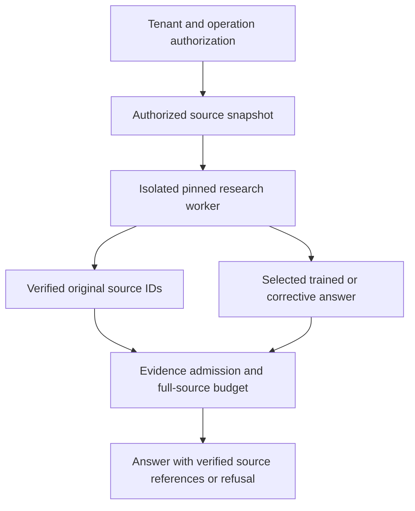

# Research RAG completion: execution, operation and limits

This implementation follows [the committed contract](RESEARCH_COMPLETION_SPEC.md).
It adds concrete implementations for the four entries that previously exposed
only a generic external HTTP contract. Existing native strategies, frozen Qwen
admission profiles and ordinary offline defaults retain their meanings.

## What is implemented and what was actually exercised

| Identifier | Implemented mechanism | Actual execution evidence | Boundary |
| --- | --- | --- | --- |
| `full_graphrag` | Microsoft GraphRAG 3.3.0 standard indexing, entity/relation extraction, Leiden communities, reports, embeddings and upstream local graph-context retrieval | Real upstream code and BGE embeddings; actual HTTP provider callbacks, sidecar and fixed worker | Generation fixtures establish algorithm execution and source lineage. Global/DRIFT search and learned generation quality are not claimed. |
| `hipporag` | Official 2.0.0a5 indexing, OpenIE, fact selection, graph construction and igraph personalized PageRank | Real upstream code, trained BGE, PPR execution and HTTP lifecycle | No-fact/dense-only fallback is an explicit error, not a successful PPR claim. Generation quality is unverified. |
| `self_rag` | Bounded always-retrieve short-form port with actual trained reflection-token logits, relevance/support/utility scoring and selected model answer | Official checkpoint converted to a hash-pinned Q4_K_M artifact; actual CPU decoding, positive/negative fixtures and HTTP lifecycle | A quantized CPU port, not full-precision/vLLM or paper benchmark parity. At most eight full passages; no generic chat-model substitute. |
| `crag` | Official trained T5 evaluator, correct/incorrect/ambiguous branching, source-preserving decomposition, refinement, rewritten external acquisition and combined evidence | Real official evaluator, all three branches, reference-forward equivalence, actual HTTP worker; real TLS acquisition transport fixtures | Generation and web-source fixtures are explicitly labelled. No live Serper or production answer-quality claim. |

The raw reports are versioned with the code:

- [GraphRAG algorithm](../reports/research_full_graphrag_v10.json) and
  [HTTP lifecycle](../reports/research_full_graphrag_http_v10.json).
- [HippoRAG algorithm](../reports/research_hipporag_v10.json) and
  [HTTP lifecycle](../reports/research_hipporag_http_v10.json).
- [Trained Self-RAG](../reports/research_selfrag_v10.json) and
  [HTTP lifecycle](../reports/research_selfrag_http_v10.json).
- Self-RAG [checkpoint/conversion provenance](../reports/research_selfrag_provenance_v10.json)
  and the same synthetic API request measured
  [before](../reports/research_selfrag_paging_before_v10.json) and
  [after](../reports/research_selfrag_paging_after_v10.json) the CPU loading/KV fix.
- [CRAG evaluator and branches](../reports/research_crag_v10.json) and
  [HTTP lifecycle](../reports/research_crag_http_v10.json).
- [External web readiness](../reports/crag_public_fetch_readiness_v10.json).

These are synthetic execution checks. A passing software gate does not establish
general retrieval accuracy, semantic entailment, clinical suitability or model
benchmark parity. The failed frozen Qwen quality report remains unchanged.

## Immutable upstream and model identities

| Component | Identity |
| --- | --- |
| Microsoft GraphRAG | `3.3.0`, source `5faaaf4f5685fa2056fa8c3bf9342cb089f2942f`; wheel versions and algorithm file hashes checked |
| HippoRAG | `2.0.0a5`, source `d5c8329422e0a0b834a15874545cb6a74b4f9b26`; clean source installation and Python source hashes checked |
| Self-RAG reference inference | `1fcdc420e48f50a7d7ab1ece5494221b93252e99` |
| Official Self-RAG weights | `selfrag/selfrag_llama2_7b`, revision `190261383b0779ff66d2f95a73c7ad267d94b820` |
| Converted Self-RAG artifact | `selfrag_llama2_7b.Q4_K_M.gguf`, 4,081,095,936 bytes, SHA256 `e6bcabadccb962ddda7f1899f1a684cb3f84dd98c07778f034d6b43d0f245e85` |
| Native CPU runtime | llama.cpp `b12631`, source `e300919cc704ddde3a8a8346a8714f57eeeee71b`; required native libraries checked before loading |
| CRAG reference algorithm | `de7c2961ae624a1483a138c5798e1f6d0c4fb0e0` |
| Official CRAG evaluator | Authors' public `finetuned_t5_evaluator` artifacts; `model.safetensors` 2,954,943,548 bytes, SHA256 `cec06c4520a5c3c114f1bbc0e64c40e8375eee61e5bb0a56a38131cf91860af1` |

The original Self-RAG weight shards, tokenizer, converter source and resulting
F16/Q4 files are individually pinned. Conversion uses memory-mapped source tensors.
The reference converter incorrectly infers CodeLlama's end-of-turn token from
vocabulary size 32016. For Self-RAG that ID is `[Utility:4]`; the preparation script
corrects only this metadata to the official EOS ID 2, leaving converted tensor
values unchanged. Runtime tests check the complete 16-token control vocabulary
and ensure its reflection tokens do not terminate generation.

The Self-RAG port uses stable conditional probabilities for the reflection groups
and greedy short-form decoding. It explicitly abstains on an irrelevant response,
`[No Retrieval]`, or `[No support / Contradictory]`, discarding the complete answer.
The last policy is stricter than unrestricted weighted ranking in the reference
runner and is recorded as a port policy, not a new calibrated threshold. Partial
support and a selected source still do not establish semantic correctness.

CPU model tensors are loaded into owned buffers instead of memory-mapping the
weight file. Every complete prompt is tokenized before inference; the KV context
then reserves the longest prompt plus the full 128-token output allowance,
rounded up to 256 and capped at 1792. All 1536-token inputs remain supported by
the same window contract. This avoids allocating a maximum-size KV cache for
short questions. Owned buffers are not memory-locked; sufficient RAM is still
required, and simultaneous workers multiply that requirement.

One identical synthetic API question retained the same plain trained answer,
37 input tokens and 16 output tokens while its observed elapsed time changed
from 296.043 to 14.156 seconds. The corrected run's exact token IDs match an
earlier separately retained raw diagnostic of the same prompt; the slow before
profile did not record the complete token stream. Across
the complete generation interval (prefill plus autoregressive decoding), major
faults changed from 5,005,150 to five; the autoregressive-only comparison was
4,889,185 to zero. Peak worker RSS changed from
4,948,090,880 to 4,272,111,616 bytes. These are one before/after filesystem/runtime
diagnostic pair, not steady-state throughput, domain quality or a universal
speedup estimate. The original timeout and intermediate eager-loading failure
are preserved in the diagnostic record. The [comparison report](../reports/research_selfrag_cpu_comparison_v10.json)
states the exact phase boundaries and uncontrolled cache state. See
[the CPU runtime details](SELF_RAG_CPU.md).

CRAG retains the reference PopQA thresholds `0.592` and `-0.995`; they are fixed
operator-independent constants and are not a calibrated policy for every domain.
The evaluator uses its native tokenizer and FP32 CPU inference. Oversized inputs
are rejected before forward execution. Dynamic-length input was compared directly
with the reference 512-padding forward; this is a numerical execution check, not
an accuracy assessment. The fixed-number decomposition preserves source slices
and fixes the reference script's short-final-strip edge case.

## Source and answer contracts

RAPTOR, LightRAG, GraphRAG and HippoRAG use `authorized-evidence-v1`: hits must map
to exact supplied original sources. GraphRAG/HippoRAG deduplicate identical text
only inside their request-local indexes and explicitly map it back to all original
authorized identities. Summaries, entities and reports cannot become citations.
Unknown or changed upstream lineage is an error. A swallowed upstream provider
exception or incomplete pipeline cannot be counted as successful execution.

Self-RAG and CRAG require `authorized-evidence-v2` and
`require_pinned_upstream:true`. Their result includes a bounded `grounded_answer`
with selected original source IDs. Here “grounded” describes the explicit source
association; it is not an automatic semantic verification claim. The main service
retains the engine's selected text, appends those explicit references, and never
regenerates it with an ordinary chat/extractive provider. Existing evidence
admission and final prompt packing remain authoritative. An answer cannot survive
removal or truncation of one of its cited sources; it produces a typed refusal.
`generate:false` omits the final answer, while the research engine may still need
internal model inference to select evidence.



For CRAG, externally acquired sources require a separate opt-in on **both** the
main backend entry and sidecar. Each snapshot records its approved HTTPS URL,
extracted text, timestamp, SHA256 and tenant-bound source ID. The parent validates
all those fields before exposing evidence. Offsets are relative to the extracted
text snapshot, not raw HTML. Web snapshots are returned with
`origin_source:crag_web` and `profile_id:crag-web-snapshot-v1`; they are not inserted
into the tenant's document database.

Historical `as_of` or nonempty source/metadata/validity filters cannot be combined
with web-enabled CRAG: the service rejects them with
`422 external_scope_unsupported` before contacting the backend. Newly fetched
pages must not silently widen a historical or filtered source scope.

The ambiguous branch retains at least one internal and one external source
within the total `top_k` budget. It requires `top_k >= 2`. If approved acquisition
returns no sources, incorrect/ambiguous branches abstain completely; neither
silently becomes an internal-only answer.

## Installing and operating the engines

All dependencies are optional. Keep each research environment independent of the
ordinary core environment and of the other research packages.

```bash
bash scripts/install_research.sh full_graphrag .venv-graphrag
bash scripts/install_research.sh hipporag .venv-hipporag
bash scripts/install_research.sh crag .venv-crag
.venv-crag/bin/python scripts/crag_local.py download --directory /absolute/crag-evaluator
```

The CRAG installer validates hash-locked dependencies. Its download command uses
the exact public files linked by the authors, HTTPS allowlisted download hosts,
bounded streaming, a shared network-acquisition deadline and atomic publication
only after size/SHA256 verification. Cached and final local hash verification are
separate from that network deadline. Existing mismatched files are not overwritten. Inference
uses only local safetensors and tokenizer files; it never loads remote model code.

GraphRAG and HippoRAG use a trained embedding provider and generator. The existing
FastEmbed BGE setup plus LiteLLM generation works in the **real worker**, including
a dedicated Gateway key and custom verified CA. Configure/preload the chosen BGE
cache before serving an offline deployment. Routed embeddings accept only an
explicit supported model/token-window mapping; a generic Gateway alias does not
imply a known tokenizer. Unknown embedding model windows fail explicitly.

The worker forwards only credentials needed by its selected providers. RAG API
keys, research tenant keys, unused upstream credentials and unrelated secrets do
not enter it. Local no-auth inference retains the existing literal-loopback
constraints. Self-RAG requires no ordinary generation or embedding credential.

For Self-RAG, first install the verified native bundle from
[the existing runtime instructions](INKLING_LOCAL.md#1-install-the-verified-cpu-runtime).
Then prepare the official checkpoint in an isolated conversion environment:

```bash
uv sync --locked --extra dev
uv venv --python python3.12 .venv-selfrag-convert
uv pip install --python .venv-selfrag-convert/bin/python --torch-backend cpu \
  -r requirements/research-selfrag-convert.txt
uv run --no-sync python scripts/selfrag_local.py prepare \
  --cache-dir /absolute/selfrag-cache \
  --llama-dir /absolute/runtime/llama-b12631 \
  --python "$PWD/.venv-selfrag-convert/bin/python"
```

Preparation checks the runtime, conversion versions, disk capacity and every
source/output digest. Cold conversion enforces at least 32 GB of free preparation
space; allow 40 GB for dependencies and working space. Serving uses the 4.08 GB quantized artifact and native
runtime, without PyTorch. Actual process memory is larger than the weight file;
the execution report records measured RSS. No preparation or download occurs
inside a Self-RAG request.

Sidecar configuration examples (substitute dedicated credentials and endpoints):

```bash
export RAGS_RESEARCH_ENGINE=self_rag
export RAGS_RESEARCH_KEYS_JSON='{"REPLACE_WITH_A_DEDICATED_LONG_KEY":"tenant-a"}'
export RAGS_SELFRAG_MODEL_PATH=/absolute/selfrag-cache/selfrag_llama2_7b.Q4_K_M.gguf
export RAGS_SELFRAG_LLAMA_DIR=/absolute/runtime/llama-b12631
export RAGS_SELFRAG_THREADS=4
export RAGS_RESEARCH_TIMEOUT_SECONDS=300
uv run --no-sync uvicorn rags.research_service:create_app --factory --host 127.0.0.1 --port 8011
```

The main RAG API uses an operator-defined backend entry:

```json
{
  "self_rag": {
    "url": "https://selfrag.example.com/retrieve",
    "tenant_tokens": {"tenant-a": "REPLACE_WITH_A_DEDICATED_LONG_KEY"},
    "timeout_seconds": 330,
    "require_pinned_upstream": true
  }
}
```

Store this object in `RAGS_RESEARCH_BACKENDS_JSON`. An explicitly configured local
development HTTP endpoint still requires `RAGS_ENV=development`; production
research endpoints require HTTPS. The sidecar's root service runs at the selected
host, and its retrieval endpoint is `/retrieve`.

For CRAG, select `RAGS_RESEARCH_ENGINE=crag`, set
`RAGS_CRAG_MODEL_PATH=/absolute/crag-evaluator`, and run the sidecar with the
isolated `.venv-crag/bin/uvicorn`. Configure an approved generation route.
Enabling external correction additionally requires:

```bash
export RAGS_CRAG_WEB_HOSTS_JSON='["en.wikipedia.org"]'
export RAGS_CRAG_WEB_TENANTS_JSON='["tenant-a"]'
export RAGS_CRAG_SEARCH_KEY_FILE=/absolute/secrets/serper-key
```

The main API's `crag` backend entry must also set
`"external_hosts":["en.wikipedia.org"]` and `"require_pinned_upstream":true`.
The search query is sent to the fixed Serper HTTPS search service using only its
dedicated key. Web pages receive no search/Gateway/API credentials. DNS answers
must be public, the connection is pinned to the validated IP while retaining
the original TLS SNI/Host, proxies are disabled, and redirects/compressed bodies
are rejected. Rewriting, DNS, search and page reads share one 30-second deadline.
At most five snapshots and 48 KB of total extracted UTF-8 text are returned.

Missing evaluator files, approved hosts or search credentials fail explicitly.
The local environment's direct public-DNS restriction and absent Serper key
prevented a live external search; the readiness report preserves that result.
No bypass, alternate unauthenticated search service or fabricated page was used
as live evidence.

## Runtime bounds and acceptance

| Boundary | Enforced limit |
| --- | --- |
| Shared request | 64 original passages, 200,000 source characters, 20 result sources |
| Standard research provider bridge | 256 generation / 4096 embedding calls; exact embedding window validation |
| Self-RAG | 8 original passages, 1536 prompt tokens per full passage, 128 generated tokens, bounded native context |
| CRAG evaluator | 16 initial passages, 512 native input tokens, 128 evaluator calls |
| CRAG generation | At most four bounded model calls, strict final JSON and selected-source validation |
| Worker | Fixed import map and command, private request directory, complete wall deadline, process-group cleanup |
| External CRAG | Exact host and tenant allowlists, public HTTPS:443, 512 KiB per HTTP response, 30-second total acquisition |

Actual engine tests and HTTP lifecycle jobs run in CI, with selected skips and
xfails rejected. The ordinary unit/integration suite remains offline. Test
fixtures distinguish actual model/algorithm execution from model-generation or
web-source control-flow simulation. Raw timing is labelled by workload; a full
HTTP lifecycle duration is not a single query latency or a production throughput
estimate. No speed comparison between unlike engines is asserted.

### Recorded local verification

The [complete-package verification record](../reports/research_core_verification_v10.json)
binds the test selection, counts, coverage and exact Python source hashes.

| Gate | Recorded result |
| --- | --- |
| Unit contracts | 1,313 passed |
| Ordinary integration contracts | 515 passed |
| Actual PostgreSQL/pgvector integration | 39 passed |
| Combined core selection | 1,867 passed, zero failures/errors/skips; 24 dedicated external cases deselected |
| Complete production Python package | 55 files; 83.8611% line and 77.3406% branch coverage; unchanged floors 80% / 72% |
| New actual algorithm/checkpoint pytest gates | GraphRAG 10, HippoRAG 6, Self-RAG 1, CRAG 2; all passed without skips |
| New actual HTTP lifecycle gates | GraphRAG 10/10, HippoRAG 10/10, Self-RAG 11/11, CRAG 10/10 |
| Static analysis, offline evaluation and wheel | Ruff, JavaScript checks, existing labelled offline evaluation, lock validation and standalone installed wheel passed |

The 24 deselected external cases are not counted as core passes. Dedicated CI
jobs provision each required resource, including the existing encoder and
RAPTOR/LightRAG paths. Overlapping focused runs are not added to the unique core
count. The offline evaluation explicitly reports configured-model/external paths
as unavailable; it is not evidence for the four new engines' answer quality.

Independent review added regression coverage for GraphRAG extraction/parser
agreement, source-scope expansion by CRAG web acquisition, preservation of both
ambiguous evidence categories, mixed-case provider configuration, trained answer
refusal, exact source projection and temporary-resource cleanup.

For a pinned sidecar, the main API preserves an allowlisted operational error
only when its HTTP status and code agree. Context/algorithm limits remain 422,
capacity remains 429, and execution/acquisition deadlines remain 504. The full
response deadline and byte/compression limits apply to error bodies too. Reasons
are fixed local text; arbitrary provider messages, unknown envelopes and
unpinned backend failures remain sanitized.

The trained Self-RAG CI job measures free storage after installing its conversion
dependencies. It records the required conversion peak and the later cache-save
peak and enforces their maximum. Only after the final artifact and manifest
verify does it remove individually verified, job-owned source shards and the F16
intermediate. A missing resource is a failed gate with evidence, never a skip or
an alternative checkpoint.

Automatic source-refresh/CDC, audio/video retrieval, image-answer generation,
distributed indexing and paper benchmark reproduction remain distinct future
work. They are not silently claimed by completing these four research adapters.
