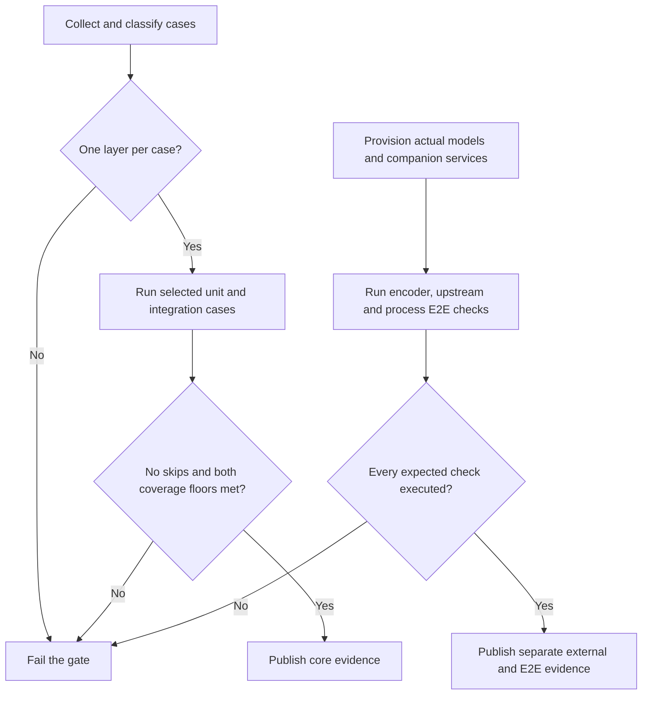

# Test coverage and code-quality review

This iteration follows the separately committed [TEST_SPEC](TEST_SPEC.md)
and [request-boundary polish specification](POLISH_SPEC.md).
Baseline: `71c484527e534e893929ada5b694440efd7bb7a9`.
Results below are measured local execution, with actual external-resource CI
gates identified separately. The PR's current checks supply the exact remote
commit, job outcomes and uploaded artifacts.

## Measured core tests

| Selection | Passed | Selected skips | Explicitly deselected |
| --- | ---: | ---: | ---: |
| `unit` | 336 | 0 | 175 |
| `integration and not external` | 170 | 0 | 341 |
| Unique ordinary cases | **506** | **0** | **5 actual model/engine cases** |

There are 511 collected pytest cases. The two ordinary selections are disjoint.
The five external cases are three trained encoders, RAPTOR and LightRAG. Each
external job selects its own marker, so unrelated cases are deselected rather
than recorded as successful or silently skipped. E2E script checks are a separate
inventory and are never added to the pytest count.

| Complete production package metric | Baseline | Current | Fixed acceptance floor |
| --- | ---: | ---: | ---: |
| Covered statements | 3007 / 3963 = 75.8769% | 3231 / 3996 = **80.8559%** | 80% |
| Covered branches | 1018 / 1486 = 68.5061% | 1117 / 1490 = **74.9664%** | 72% |

Both measurements include all 27 production Python files and use parent-process
ordinary tests. MCP, research worker subprocesses and actual optional inference
have separate execution evidence. Coverage does not establish behavioral or
answer-quality completeness. No production module is omitted and no new coverage
exclusion was introduced. [Baseline per-file evidence](testing-baseline.json)
records the original measurement; [current per-file evidence](testing-results.json)
records this local run. CI publishes its own JSON, XML and HTML.

## Corrected defects and code smells

| Finding | Correction | Meaningful verification |
| --- | --- | --- |
| HTTP 200 model responses with malformed JSON, missing nesting or invalid values escaped as uncaught exceptions | Small response-object/first-record/finite-number helpers produce fixed typed 502 errors, while preserving valid request bodies, prompts and outputs | OpenAI embedding/chat/vision and Anthropic malformed envelopes, vectors, booleans, huge integers, text blocks, API response sanitization, valid protocol and concurrent request-local usage |
| Image-route exception inheritance misclassified upstream failures | Preserve typed provider errors before the broader client-validation ValueError handler | Actual ASGI/SQLite image ingestion returns safe 502, leaves existing indexes unchanged, and preserves valid captions/searchable generated provenance |
| SQLite setup happened before cleanup ownership began | Row factory and PRAGMAs now run inside the connection's existing rollback/finally scope | A tracked real connection that fails initialization is closed; actual mid-transaction failures roll back revisions, FTS and derived indexes |
| Implicit sequence truncation obscured alignment intent | Adjacent chunk pairs use `itertools.pairwise`; dimension-checked vectors and validated source records use `zip(..., strict=True)` | Existing chunking, ranking, multimodal and upstream lineage contracts retain valid-input behavior; no ranking formula or calibration input changed |
| Mixed `and`/`or` guards obscured validation precedence | Explicit parentheses preserve the same conditions | The original and new validation matrices pass; production Ruff B/RUF021 checks run in CI |
| Test counts mixed pure contracts, real storage and optional skipped models | Explicit per-function legacy classification, new markers and strict execution gates | Child-pytest negative controls reject unclassified/conflicting cases, collection skips, runtime skips, xfail and xpass; JUnit and inventory distinguish deselection |

Coverage checks reject new suppression pragmas and custom exclusion/partial-branch
rules, and compare the unchanged default Protocol declarations against the
recorded baseline. Root-level pytest hooks register options before parsing an
existing inventory path, so rerunning the same command remains supported.

The FastAPI `File` descriptor is narrowly registered as an intentional declarative
default for Bugbear; no rule is broadly disabled. Valid provider behavior,
calibrated profiles, prompts, frozen datasets and recorded quality reports remain
unchanged. Provider error text and credentials do not appear in client errors.

## Added contract coverage

The iteration adds 226 ordinary cases: 145 unit, 58 service/storage integration,
and 23 CI-evidence integration controls. Unit contracts cover configuration,
native algorithms and provider adapters. Integration contracts exercise actual
UTF-8/PDF extraction, auth-before-extraction, upload limits, CAS races, revision
and tenant filtering, deletion during indexing and SQL rollback after mutation
has started. A pre-transaction provider error is not treated as rollback proof.

RAG configuration, native algorithms and storage reach 100% statement coverage
in this measurement; provider adapters and vision ingestion are checked together for malformed envelopes
and preserved successful requests. These figures
describe executed statements, not proof of every possible input or outcome.

## Request-boundary polish and setup verification

The follow-up adds **19 cases: one unit and 18 integration**, after committing
its specification. The focused API/upload/reindex/provider/vision selection
passed 73 cases, and the complete core selections above passed without selected
skips. The companion's actual HTTP/worker/MCP v0.2 and v0.3 scripts passed with
the new rejection cases; they use real services and independent workers.

| Reproduced problem | Correction and evidence |
| --- | --- |
| Nonfinite values and unpaired Unicode surrogates made the default validation response fail with 500 | A RequestValidationError-only handler emits serializable `type`, `loc`, `msg` details without input/context; raw malformed JSON and ordinary errors return 422 before inference or mutation |
| Invalid nested metadata could be saved and break later reads | Document/filter metadata is validated as finite UTF-8 JSON; rejection leaves the existing source, revisions, FTS, graph and other tenant records unchanged |
| A valid UTF-8 file needing 1,025 chunks failed with 500 | JSON/upload/image-caption ingestion share the existing ValueError-to-400 mapping; actual configured chunking reproduces the bound, typed provider 502 errors remain intact, and unexpected server failures remain 500 |
| Production examples used short credentials and inconsistent tenant names | The companion README generates three distinct credentials and coherent tenant-a maps into ignored owner-only files; exact commands were exercised in paths containing spaces with actual configuration/authentication and overwrite refusal |

Valid Chinese, emoji and combining marks retain original text, metadata and
citation offsets. No retrieval algorithm, tokenizer accounting rule or frozen
quality artifact changed. Independent review of the companion request handling
found no further blocker after the specified corrections.

The initial full local rerun was interrupted by automatic approval review when
ONNX Runtime attempted diagnostic network traffic. The complete successful
rerun sets `ORT_DISABLE_TELEMETRY=1` before Python starts, as documented in
[ONNX Runtime privacy controls](https://github.com/microsoft/onnxruntime/blob/main/docs/Privacy.md),
and also disables Hugging Face telemetry. The README now uses these pre-launch
settings, matching CI. The interrupted attempt is not counted as a pass.

## Required CI and E2E paths

- The ordinary job runs the 36-question labelled evaluation and real HTTP smoke,
  alongside the disjoint unit/integration selections and full-package coverage.
- The encoder job provisions and executes BGE, ColBERT and paired CLIP. Research
  matrix jobs execute the pinned official RAPTOR or LightRAG algorithm with real
  BGE and their real HTTP lifecycle scripts. Their deterministic generation
  fixtures remain explicitly identified.
- The companion Agent workflow pins this RAG implementation and exercises actual
  APIs, independent workers, both MCP bridges, SQLite/PostgreSQL recovery,
  cancellation, retry/deadline limits, SSE resume and real Chromium UI behavior.
  Its [test review](https://github.com/MasterLKH180cm/agentic-system/blob/feat/spec-driven-v02/docs/TEST_REVIEW.md)
  separates those checks from pytest counts and parent-process coverage.
- Missing selected resources fail. Reports and diagnostics are uploaded even
  after a failure; a missing report cannot be represented as a pass.

Use the executable commands in [README](README_REFERENCE.md#validation-and-measured-limits).
Run unit coverage first without `--cov-append`, then integration with append, to
avoid accidentally reusing an old measurement. Generated evidence stays under
`reports/testing/`; raw runtime artifacts are not checked in as source code.

## Review boundaries

The known frozen Qwen profile still has **21/21 correctness checks but 7/11 quality
gates**, with promotion failed and no profile enabled by default. The actual two
calibration contract cases plus historical-report audit remain distinct from a
fresh complete 472-forward quality benchmark. No target, dataset or threshold
was changed to make a functional gate green.

Microsoft GraphRAG, HippoRAG, trained reflection-token Self-RAG and paper-specific
CRAG remain external implementation requirements. These tests do not complete
those engines or establish live paid-provider generation quality. Capacity,
adversarial load and distributed availability require separate measurements.
